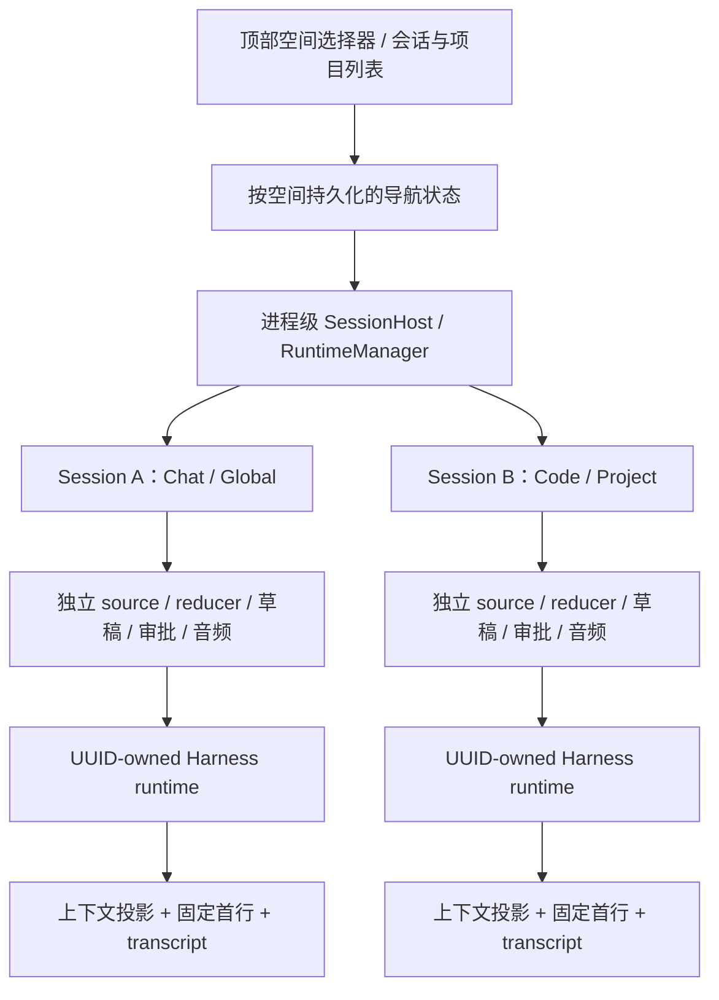
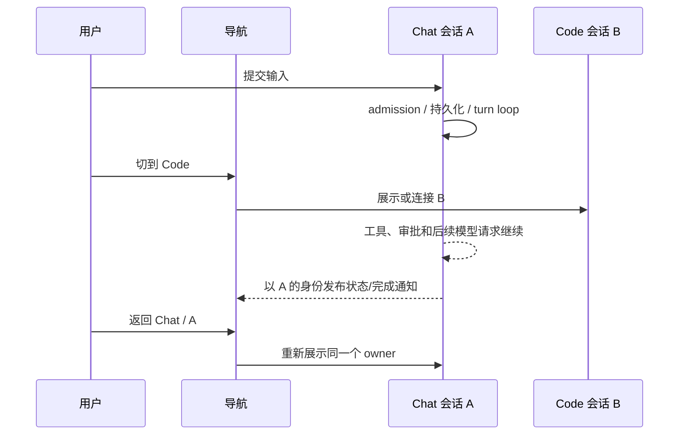

# Chat / Code 独立会话空间与上下文设计

文档日期：2026-11-01（America/Los_Angeles）。

本文描述本轮修订后的产品契约、源码架构和继续实现时必须遵守的约束。**设计契约已经确定，但整条协议 32 集成链尚未完成验收**。2026-11-02 已将 main 合入任务分支，App 锁定的 Harness 与 TS 协议均为 32；合并后的移动端 FFI 重生成、原生编译和设备验证仍在推进。源码位置、不可变依赖、验证记录和执行顺序见[交接文档](../plans/2026-11-01-conversation-spaces-handoff.md)。

## 1. 已确定的产品决策

| 项目 | 最终约定 |
| --- | --- |
| 顶部 Chat / Code 选择器 | 切换可见的会话空间与导航位置。 |
| session.mode | 在创建时确定，此后保持不变。恢复、打开、修改 cwd 均不能改变它。 |
| 普通 New Chat | 在当前空间创建 Global、无逻辑 Project 的新会话；不能继承上一个页面的 Project。 |
| 项目内创建 | 必须由明确的项目内新建入口发起，并捕获 Project 与 mode。 |
| 项目和历史列表 | 只显示当前空间对应的项目成员关系与会话；先过滤，再限制数量。 |
| 正在运行的 turn | 空间、项目、会话导航均不构成取消理由。 |
| 跨空间继续 | 创建带来源链接、可编辑的 Global 摘要草稿；发送后才开始目标 Agent。 |
| CLI | 公共入口只有 Code；不提供模式选择或修改已有会话模式的接口。 |
| 旧协议和旧数据 | 删除旧 API、旧解码器、迁移与缺字段兜底；仅接受当前格式。 |

“普通 New Chat 默认无项目”和“应用首次打开时选中哪个空间”是两个独立决定。恢复上次选择的 Code 空间，不会使普通 New Chat 继承 Project。

参考 UI 的价值在于把空间选择提升到应用导航层。产品使用 Chat / Code 命名即可，无需依赖参考图中的品牌名称。模式选择不等于模型选择、Plan/Execute、权限等级或是否允许使用工具。

## 2. 三种身份必须分开

### 2.1 会话 owner

概念上的会话身份为：

```text
SessionOwner = { session UUID, logical scope, fixed mode }
LogicalScope = Global | Project(projectId)
```

实际查找还必须带上本地/远程宿主和配置目录等命名空间，避免不同设备或存储根中的同名 UUID 混用。

- UUID 是执行、恢复和草稿归属的稳定身份。
- logical scope 决定无项目/项目归属、导航与用户状态的存储位置。
- mode 决定该会话的行为配置及所属空间。
- 远程会话还有连接与设备身份，不能放入本地 SessionHost 冒充本地执行器。

已有 owner 再次注册时，scope 或 mode 冲突必须报错。不能把注册操作当作移动会话或切换模式的接口。

### 2.2 执行工作目录

```text
Workspace = { cwd, exact transcript path, filesystem/trust context }
```

Global 会话仍然需要真实目录供工具运行。Desktop 使用应用私有的 `general-chat-workspace`；移动端使用平台已有的 Global workspace。

`cwd` 可以变化。Global 会话执行 `/cd` 进入某个项目目录后仍然是 Global；Project 会话离开项目目录后也不会自动变成另一个 Project。目录规则与文件系统信任仍按实际执行环境处理，不能据此反推逻辑 Project。

合并后集成采用稳定物理来源策略：普通 `/cd` 在原 transcript 中持久化 `relocated` 工作目录记录，保持该会话已经捕获的物理文件路径；alias 只用于发现。`/cd` 的发现记录必须限定本次会话 UUID/来源，不能把原 bucket 的其他历史带入新 Project；显式 `/add-dir` 的既有目录发现范围另行保留。这样 cwd 变化不会使调度目标、永久 owner 记录或冷恢复指针失效。显式 fork/retarget 的发布与 authority 转移仍有各自的校验，不能把目录 alias 当作同 UUID 其他文件的授权。

恢复时必须保留实际捕获的 transcript 路径。不能仅凭 UUID 和当前 cwd，重新猜测另一个 worktree 中的同名 JSONL。

### 2.3 turn 与异步操作身份

```text
TurnOwner = { SessionOwner, engine/source generation, client turn id }
AudioInput = { connection/operation incarnation, local input id }
Navigation = { captured target owner, navigation operation id }
```

不同操作使用各自的身份校验。迟到的连接结果不能覆盖新选择；旧 turn 的终态不能清除新 turn 的恢复记录；旧音频响应不能解除下一次输入的暂停。

Desktop 音频在启动前即保留原 runtime；同 UUID 的选源替换、`/cd`、关闭或重启不能绕过该 reservation。native operation 返回 failed 不等于资源已关闭：若仍有 unknown、helper close binding 或 hosted provider 的 child capture/play identity，保留原 owner，直到全部精确关闭得到确认。其他 UUID 的普通导航仍可继续，正常完成和明确 never-admitted 则及时释放。

## 3. 总体架构



共享 Harness、目录发现能力和物理 transcript 存储，不代表共享一个正在被改写 mode 的执行器。Chat / Code 历史通过固定元数据和空间成员关系隔离；不要求复制业务文件，也不要求为两个空间维护两套消息数据库。

屏幕只选择当前可见 owner。SessionHost / RuntimeManager 持有执行资源，其生命周期长于单个会话页面。

## 4. 导航与运行生命周期

### 4.1 切换空间

1. 保存离开 owner 的文本、附件、来源链接和当前导航位置。
2. 仅更新 `activeMode`，并读取目标空间保存的 Project/session。
3. 已驻留 owner 直接重新展示；未驻留 owner 才进入连接或恢复。
4. 后台 owner 保持 source、事件监听、审批和 turn 运行。
5. 异步结果只能提交给它捕获的 owner；导航操作过期后不能抢回前台。

切换路径不得提交 Cancel、关闭仍有活动的音频 lane、销毁后台 reducer，或为同一个 UUID 启动第二个 executor。



### 4.2 运行资源何时可以释放

“不在前台”不能作为 idle 的判断。至少需要考虑：已提交但还未显示 streaming 的输入、排队输入、工具、permission/question、Fusion 或其他独立任务、realtime 待接纳输入和后台清理。

Desktop 对 slash command 在发送前同步建立 pending lease；收到相关终态，或把执行身份移交给已验证的独立任务 roster 后才释放。不能等异步 Started 才开始保护 runtime。

移动端设置变更引发的 idle 重建需要：确认可重连 → 退役旧 source → 等待 native shutdown/release receipt → 创建新 source。失败或超时保留草稿及可重试状态。不能靠 UI 先设为 idle 来绕过 native owner gate。

系统进入后台、后台预算到期和用户明确 Stop 有各自的处理规则；空间导航不能伪造这些生命周期事件。

当前移动端驻留 owner 缓存尚未形成完整的容量与安全淘汰策略。后续若增加淘汰，必须证明队列、审批、音频、后台生产者均已静止；不能直接对仍运行的 owner 做 LRU 回收。

## 5. 上下文装载策略

### 5.1 按来源与权威装载

| 层 | 内容 | 装载时机与作用域 | 必须保留的边界 |
| --- | --- | --- | --- |
| Host 基础指令 | 平台约束、通用 Agent 行为 | 组装请求时，由 Host 提供 | 用户文件或工具结果不能替代它。 |
| 固定行为配置 | Chat 或 Code 的行为头 | 由 session.mode 决定，整个会话固定 | UI 导航不重写它。 |
| 用户与目录规则 | 已授权偏好、适用的项目/目录说明 | 按实际 session/workspace 与既有规则加载 | 逻辑 Project 与目录规则分别判断。 |
| 历史与当前输入 | 有效消息、工具证据、用户新请求 | 以 owner 为单位构造模型投影 | 排除标记、原始身份和来源不能丢失。 |
| Skill catalog | 名称、描述、定位信息 | 先发现，后按任务选择 | 展示 catalog 不执行 Skill body。 |
| Skill 激活 | 选定 Skill 的完整说明及引用材料 | 明确调用或满足适用条件时 | 由 Host 标记身份、摘要和 instruction epoch。 |
| MCP / Plugin catalog | 可用服务、能力与发现元数据 | 由当前 Host、连接和授权决定 | 安装/可发现不等于执行授权。 |
| 工具 schema | 当前请求可用工具的定义 | 小集合直接提供；已有 deferred 路径按需发现 | 工具描述不授予权限，调用仍通过授权检查。 |
| MCP prompt / resource | 外部提供的提示模板、文件和资源 | 用户/任务需要时读取 | 外部内容作为带来源材料，不自动升级为 Host 指令。 |
| Memory / 检索材料 | 与请求相关的持久知识 | 按相关性、scope 和既有检索策略加载 | 不整库灌入，也不将其视为新的用户命令。 |
| 实时状态 | 当前 cwd、运行状态及既有动态上下文 | 按请求重新计算 | 不能混入另一个 owner 的可变状态。 |

这是一套共同的装载管线。Chat 不等于禁用工具，Code 也不等于无条件装载所有工程工具、Skills 和 MCP schema。

### 5.2 Chat 与 Code 的差异

| 维度 | Chat | Code |
| --- | --- | --- |
| 默认行为 | 研究、解释、写作、学习，完成用户请求的工作。 | 检查、实现、调试、验证和交付工程任务。 |
| 普通新建的逻辑范围 | Global。 | Global；项目内工作由明确项目入口创建。 |
| 工程上下文 | 任务相关时读取，不因 mode 自动假定有项目。 | 有实际 workspace 时使用工程流程；不因 mode 虚构 Project。 |
| Skills / MCP / Plugins | 使用同一套按需发现与授权机制。 | 使用同一套按需发现与授权机制。 |
| 模型、账户、信任与权限 | 独立配置与检查。 | 独立配置与检查。 |

模式本身不能成为越权调用、隐式安装插件或在页面切换时执行 setup/hook 的理由。

### 5.3 五个装载阶段

1. **创建/恢复**：确认 owner、固定模式、instruction epoch、实际 transcript 和 writer 权限，再进入启动流程。
2. **发现**：读取适用 catalog 与规则；无关能力的完整说明保持未展开。
3. **请求组装**：基于当前 owner 和有效消息集合生成系统上下文、历史与工具集合，并记录 manifest。
4. **按需扩展**：读取 Skill body、工具 schema、外部资源；后续 turn 保留正确的来源与授权。
5. **压缩/恢复**：恢复投影成员关系与有效 Skill，不重复执行已发生的 Skill 命令、hooks 或 setup。

缓存必须有与其内容对应的 scope。跨 owner 共享不可变 catalog 可以成立；共享“当前激活 Skill”“当前 provider 工具开关”或可变 prompt 状态则需要明确隔离。不能引入进程级 `currentMode` 来控制所有会话的上下文。

### 5.4 静态 prompt 快照与动态上下文

已有 `prompt_snapshot` 功能受 feature gate、主会话/辅助请求及自定义 prompt 等条件限制。符合条件时，首次请求可以保存静态 system prompt 和初始内联工具描述；动态部分仍按请求重算。不能假定所有运行路径都会产生或复用该快照。

恢复会话不能制造一份原先不存在的静态快照。独立 fork 不能直接继承源会话计算得到的冻结 prompt；显式用户 prompt 与 Host 计算产物分别处理。authenticated background handoff 保留原已接纳上下文。

## 6. Skill 权威与 instruction epoch

`instructionEpoch` 与固定 mode 独立。导航、重新展示和同模式检查都不能递增它。

- Host 接纳的 Skill 激活带有 `skill_activation` 来源、Skill 身份、内容摘要/引用以及 `context_epoch`。
- 恢复时仅重新登记当前 epoch 中已被接纳的激活，不重新调用 loader 或执行附带命令。
- 独立 fork 使用新的 instruction epoch；复制过来的旧激活保留审计证据，但退出模型指令投影。
- 精确恢复已接纳的后台任务保留原 epoch。
- 新 epoch 必须大于相关源 epoch，并在写文件、发布任务或启动 hooks 前检查溢出。
- 持久化 epoch 限于 JavaScript 安全整数范围 `0..=2^53-1`。

同一段文本可能同时出现在 Skill 指令与用户证据中。退役依据是 Host 标记与消息成员关系，不能按文本相等把用户原文一并删除。

压缩、resume 和分支处理需要保留模型排除标记、Skill 来源、原始 UTF-16 内容及 native computer receipt 边界。界面文本与原始 source code units 不能相互替代。

## 7. ContextManifest：解释当前投影

核心结构：

```json
{
  "session": { "session_id": "44444444-4444-4444-8444-444444444444", "mode": "chat" },
  "projected": false,
  "blocks": []
}
```

每个 block 包含 `id`、`source`、`version`、`kind`、`scope`、`reason`、`bytes`。`kind` 分为 instruction、evidence、capability、state；`version` 用于内容指纹识别。

- 返回最近一次实际组装的请求清单，不承诺是完整磁盘历史。
- 尚未组装时 `projected=false`；这不意味着会话没有 mode 或没有历史。
- 清单不返回完整 prompt、秘密、凭据，也不是精确 token 计费结果。
- 当前实现最多保留 384 个 manifest block；超出部分合并为指纹和字节数摘要。
- 查询不调用模型、不改变模式，也不能伪造 SessionStarted 去重置客户端历史。
- 客户端确认 identity 时必须同时匹配 UUID 与 mode；manifest 不是新的权限授予接口。

## 8. 当前协议 32

| 命令/事件 | 当前字段与语义 |
| --- | --- |
| `new_session` | `mode` 必填；`cwd`、`model` 可选。 |
| `resume_session` | `session_id`、`expected_mode` 必填；`cwd` 可选。mode 不匹配应在产生副作用前拒绝。 |
| `list_sessions` | `mode`、`limit` 可选；过滤先于 limit。 |
| `session_started` | 报告新 owner 的 `session_id`、`mode`。 |
| `session_resumed` | 报告恢复的固定 owner，同时携带现有恢复信息。 |
| `get_context_manifest` | 只读查询。 |
| `context_manifest` | wire 字段为 `manifest_json`，其中的 session 为 `{session_id, mode}`。 |
| `prepare_session_handoff` | `request_id` 与 `target_mode`；准备草稿材料。 |
| `retry_session_handoff` / `cancel_session_handoff` | 操作指定 request，不影响源 turn。 |

不存在 `set_session_mode`、`session_mode_changed`、pending-mode 或模式 revision。`SessionModeSnapshot` 只包含 `session_id` 与 `mode`。

SDK Rust DTO、snapshot/ordinal 合约、TS 生成类型、客户端 validator、Swift/Kotlin FFI 绑定和运行二进制必须来自同一最终版本。源码写成 32、运行时仍使用 31 不能构成有效集成。

## 9. transcript 与索引格式

### 9.1 固定首行

每个当前格式 transcript 的首行必须恰好是一条：

```json
{"type":"fixed-session-mode","sessionId":"44444444-4444-4444-8444-444444444444","sessionMode":"chat","instructionEpoch":0}
```

该记录先于普通消息、空会话锚点和启动 hook 产物。闭合 schema 使用强类型解析，拒绝未知字段、重复字段及转义后重复的同义字段。UUID、mode 和安全整数 epoch 均需合法；完整文件不能再出现第二条固定模式或旧 `session-mode` 记录。

普通消息继续使用已有精确保真 JSON/UTF-16 路径，不能因首行改为强类型解析而损坏用户文本。

### 9.2 空会话与调度目标

新建草稿可以还没有用户消息。调度器若要把一个新 TaskSession 的 UUID 绑定到持久任务，必须先在 owner 的 writer 权限下落盘空会话锚点，并完成文件与父目录同步；然后才向任务绑定方确认。

私有 `--scheduled-durable-anchor` 仅用于这种新目标；不能成为公共恢复绕过入口。相同 UUID/mode/cwd 的空锚点重试幂等，其他 owner、错误工作目录或真实已有对话不能被新调度草稿接管。重定位元数据也需要验证。

### 9.3 各端本地状态

| 平台 | 当前实现 |
| --- | --- |
| Desktop | `userData/conversation-spaces.v2.json`：activeMode、项目成员关系、导航、已登记 owner；Global workspace 为同级 `general-chat-workspace`。 |
| Android | `filesDir/scope-state.json` 使用 version 2；Project/session 索引要求显式 mode 与 membership，项目和 Global 索引分别保存。 |
| iOS | `ProjectScopedPreferences` 按空间、scope、UUID 保存导航与草稿；项目内 `session-spaces.json` 和 `global-session-spaces.json` 使用当前 session index 格式。 |

项目 manifest/index 中仍可存在当前合法的 version 1；不能仅根据数字 1 就断言是旧数据。是否有效取决于当前完整 schema 和必需字段。

损坏、缺字段或旧格式文件不能被静默读成空列表后覆盖。删除旧 reader/迁移逻辑，不等于在此次变更中递归删除用户的项目或业务数据；实际旧文件清理应限定对象与路径。

### 9.4 冷恢复

顺序为：捕获精确 source → 验证固定身份与 expected mode → 获取相应 authority/claim → 恢复原 UUID、epoch、cwd、消息和 turn journal → 接入启动服务、hooks 和后续工作。

允许修复的损坏范围仅限已确认的 torn JSONL 尾片段。修复前必须在固定文件 authority 下比较原始字节；完整行或中间损坏保持报错。不能以恢复为名对旧数据做补 header 迁移。

### 9.5 精确来源与 writer authority

移动端冷恢复同时提交 UUID、expected mode 和持久化的 transcript path；热恢复也经过同一来源捕获与校验。客户端原样保留 SDK 返回的 guest/host 路径坐标，由 SDK 使用可信挂载映射解析，不能按当前 cwd 重建路径。缺路径或原文件丢失直接失败，即使其他目录存在同 UUID 的副本也不能接管。

显式、未限定来源的 Desktop/CLI UUID 查询可以使用严格唯一查找；多个匹配必须报错。查找一旦选定来源，后续 claim、bootstrap、writer activation 必须继续使用捕获的 root/file identity。fork 使用发布新文件时返回的 authority，不能再次按路径打开并把替换文件当作刚发布的目标。

故障边界是所有合作的 SDK writer 通过 UUID lease 和共享持久化事务协调，以及对可观测外部 root/leaf 替换的拒绝。检测到替换后不得确认写入成功或幂等成功；可能已经落盘的操作应保留恢复证据并报告不确定状态。正常 compaction、尾片段修复和 cwd 重定位在事务内迁移 authority，不能为避免竞争而停用这些能力。这里不承诺抵御绕过锁的同用户进程在最后一次检查之后主动更换命名空间；这不是跨文件系统 inode CAS 或 WAL 协议。

Desktop 的重命名、更新时间和归档预检也遵循精确来源合同。行操作先携带所显示来源的 scope/path；打开重命名对话框或归档预检时，Host 捕获 opaque token，确认时继续使用同一 token，不能重新搜索 UUID。Host token 绑定原 renderer、runtime 和连接代次，取消、过期或窗口关闭释放保留的 runtime。

热 owner 的 metadata 操作通过原连接 `session_metadata` RPC，在 UUID lease 与原 durable writer 事务中执行；冷来源使用私有 `--session-metadata-json` 子进程。文件身份保留为 opaque receipt 字符串，不经 JavaScript number 解码。冷来源捕获后若出现新的 live owner，确认操作失败并要求重新选择，不能自动改走新 runtime。

metadata observer 超时只表示结果未确认；已接纳写入继续持有 lease 完成，不能杀进程或释放 writer。Bridge receipt 限原连接存活，断线后不重投；旧 socket 的迟到关闭或响应不能影响替换连接。归档须预检原来源与关联调度任务，并拒绝正在执行或等待交互的 owner，不以导航或关闭窗口取消 turn。

fork 的线性化点是 claim 内读完的不可变 source snapshot；之后原会话继续写入不使已经正确发布的新分支失效。新分支的 publication receipt 必须保留到首次 mount；Bridge 进程重启后的新目录选择是一次新的捕获，不宣称跨进程永久 inode 映射。

当前 FileHistory/rewind 生产接线属于 Desktop/CLI；移动 runtime 未安装 FileHistorySink，也没有对应原生还原入口，本轮不新增该能力。FileHistory checkpoint 的文件路径属于原始编辑位置，不能在恢复时按当前 cwd 重新展开。当前格式固定原绝对路径和原父目录 authority，恢复使用 no-follow 的读取、删除与写入；无法证明出处的记录直接拒绝。Write 新建多层父目录后，需要使用实际写入所打开的父目录 receipt，才可完成对应 pending checkpoint，不能从后来出现的同路径目录猜测归属。

`/rewind` 与 headless file rewind 使用 claim 内捕获的同一 source snapshot；transcript 重写经 checked staging 发布并返回新 target authority，不能原地 truncate，也不能在失败后重新捕获替代 inode。工作树文件还原不是跨文件原子事务：部分失败必须报出并返回失败，不能报告全部成功。普通 fork 在 source snapshot 捕获完成后即独立，不因新分支 runtime 构建而持续占用原会话 claim。

### 9.6 调度来源与永久 owner 记录

| 目标类型 | 当前格式必需的执行身份 |
| --- | --- |
| 新会话 / 首次 TaskSession | `sessionMode`、`sessionScopeKey`。 |
| SelectedSession | `targetSessionId`、`targetSessionTranscriptPath`、`targetSessionMode`、`targetSessionScopeKey`。 |
| 已绑定 TaskSession | `ownedSessionId`、`ownedSessionTranscriptPath`、`ownedSessionMode`、`ownedSessionScopeKey`。 |
| Run receipt | 实际执行的 session ID、path、mode、scope key。 |

scope key 是宿主内部路由信息，不是授权凭据。claim 和首次绑定比较完整来源元组；任务编辑或 cwd 改变后不能用新配置解释旧 run。任务的历史 runs 可裁剪，任务也可删除，因此 SDK 另存不会随任务或历史裁剪而消失的 owner reservation ledger。先写 ledger、后写 task 是两步持久化；reservation 证明 owner 已分配，并不证明模型已运行。

移动端执行采用两个准入边界：原生生成候选 UUID 后、任何可发现来源写入之前调用 `beginOwner(candidate)`，App 校验并只预留这个 UUID；SDK 落盘来源和 reservation 后调用 `confirmOwner(receipt)`，App 持久化 owner 才允许模型启动。其他 UUID 的普通 New Chat 和已有 turn 继续运行。确认后即可释放预留，不应持有覆盖整个模型 turn 的全局锁。

此准入保证覆盖同一 App 进程中的前台与后台 scheduler（iOS BGTask、Android WorkManager 常规路径），各 scope 的 ledger 事务保护合作 SDK 写入；不将启动扫描宣称为跨所有 scope 的跨进程全局原子 claim。

取消必须等待本次原生 admission 的 `cancelAndWait` 屏障，再严格核对 ledger 与 App mirror；核对失败只冻结新的 claims，保留既有 owner 的执行。负责调度的移动 controller 不创建对话 header/anchor，也不能接受普通对话输入；实际 child 在准入后启动。没有显式 automation 配置的移动 fire/create/update 直接拒绝，不能产生无 owner 的临时会话。

## 10. 跨空间继续

它与独立 fork、后台 exact handoff 是三种操作：

| 操作 | 目标 | 上下文 |
| --- | --- | --- |
| 跨空间继续 | 新的 Global 可编辑草稿 | 源会话已提交证据的隔离摘要与来源链接。 |
| 独立 fork | 新 session / 新指令 epoch | 按 fork 契约复制证据，退役复制的旧指令权威。 |
| authenticated background handoff | 原已接纳任务的连续执行 | 保留原 owner、epoch 和 admitted context。 |

跨空间准备流程：

1. 在源 writer 的短事务中捕获已提交 cutoff，不持有其完整 turn gate。
2. 重建允许进入摘要的证据；尊重模型排除成员关系。
3. 不带入 system/Skill 指令、审批、pending tool、provider continuation 或不透明 reasoning。
4. 发起一次工具禁止的隔离摘要请求；源 turn 可以继续。
5. 保存源 UUID、mode、workspace、cutoff、requestId 与摘要原始文本。
6. 只有用户发送目标草稿时，目标 Agent 才开始运行。

同 requestId 的 Prepare 幂等。显式 Retry 重用同一份固定 capture，不重新扩大 cutoff；Cancel 仅取消摘要。迟到结果保留为可接收草稿，不覆盖用户的新编辑或较新的导航。

当前 per-owner 管理器限制：同时运行 16 个操作、重放 64 个终态、保留最多 8 份可重试 capture，重试材料有效期 5 分钟。它们限制摘要操作的资源，不代表 SessionHost 的总体容量策略已经完成。

## 11. Desktop 集成

- `ConversationSpaceStore` 管逻辑归属与空间导航，`sessionRuntimeManager` 管 UUID-owned runtime。
- `host.ts` / `bridge.ts` 协调创建、恢复、切换、catalog 和异步结果归属。
- React 当前屏幕订阅所选 owner；后台执行状态由保留的 runtime 继续更新。
- 普通 New Chat 始终传入 `projectId=null`；目录重定位只更新 workspace，不修改逻辑归属。
- 搜索、recent、pinned、archived、项目可见性使用同一空间约束，不能只过滤左侧主列表。
- scheduled 目标 mode 由捕获的来源 owner 或明确的控制器策略决定，不读取后来切换后的前台 mode；默认控制器为显式 Code。
- 新建调度 TaskSession 等待实际 runtime ready 与固定身份确认后才 ACK 绑定；已有目标不重复走新草稿锚点路径。

## 12. Android 集成

- 进程内 `SessionHost` 保留每个 owner 的 ViewModelStore、ChatViewModel、source、监听、文本、附件、审批/问题与语音控制器。
- `SessionOwnerRegistry` 和 native owner claim 共同阻止重复挂载；`OrderedSelectionWriter` 约束异步选择写入顺序。
- 连接结果、首条提交和后台恢复使用捕获的 mode/scope/UUID 与 source generation 校验。
- AttachTurn 之前确保 SharedFlow 订阅已建立，避免 replay=0 时丢失同步接纳事件。
- recovery checkpoint 按 owner 更新，旧 turn 终态只能清理对应 turn，不得清除同 owner 的下一次提交或其他 owner。
- Computer Use、音频回调和清理以发起 engine 注册，不回退到“当前 engine”。
- 通知/深链携带固定 owner；错误或缺少 mode 的入口拒绝，不默认 Code。

## 13. iOS 集成

- `@MainActor` 的 `SessionHost` 保留 source、model、draft、执行租约、通知与音频归属；SwiftUI 页面只改变选择。
- 同一 UUID/scope/mode 的驻留 entry 可以直接重新展示；cwd 变化不产生新 owner。
- 设置重连先 drain 旧 source 并等待 native release receipt，再 prepare 替代 source。
- UserDefaults 草稿与原始 UTF-16 source 按 owner 保存，失败的目标连接不能把旧草稿写给当前会话。
- Live Activity、通知和深链同时核对 UUID、mode、workspace 与当前支持的 URL 结构。
- 音频输入在用户实际提交时同步建立待接纳 pin，不能等异步 FFI 任务启动后才保护 source。

## 14. 远程会话与审批能力

### 14.1 普通远程会话

远程 mode 必须由匹配 session 的可信 catalog/snapshot/lifecycle 提供。未知 mode 保持 Loading，客户端在有界 FIFO 中暂存后续更新，不能先以 Code 展示或允许控制。

第一份已确认 mode 在连接实例内固定。后续缺省值不能清空它；冲突进入明确 Error，保留原已提交 base/cursor，拒绝后续记录、历史/图片读取和控制。建立新客户端才重新开始确认。

移动端暂存上限为 128 个更新 / 4 MiB，溢出报错。共享 Rust client 也须在 snapshot 提交前校验 held records 与增量，避免“先发布错误历史，再报冲突”。

发送 prompt/retry 在未知或冲突状态下返回实际错误，mobile FFI 继续传播；UI 应保留原文、附件及原始 code units，不能在 native 拒绝后丢失草稿。

### 14.2 Team 单次审批

当前 Desktop 保留的 capability ID 为 `team-approval:` 加精确 32 个 ASCII base64url 字符，即 `[A-Za-z0-9_-]{32}`。它是单次审批能力，不是普通会话，没有 Chat/Code mode。

该分类只允许显示 pending permission 并响应 allow-once/deny；prompt、retry、cancel、question、模型设置、history/image 和文件操作均不可借此放行。显示为可响应状态也不能给它补一个虚构 Code mode。

## 15. realtime 与媒体连续性

Provider response 的结束不等于 Agent 输入的结束。Agent 可能仍在等待工具、审批或后续模型请求。

- 只有本地已成功接纳的文本/音频输入才能启动 Agent turn；未接纳的 provider 输出/工具活动不能自行创建 turn。
- `RealtimeAgentOutput` 分离 Provider 事件、带 local turn id 的 `AgentResponseStarted` 与 `AgentTurnCompleted`。
- terminal 在对应工具与 final continuation 收敛后发布；音频适配器按 owner 与 operation 串行消费。
- OpenAI 结合 response id 和匹配的 raw `response.done` frame-tail 处理完成；迟到的旧帧不能结束新 turn。
- Gemini 必须检查 codec 的 interaction status；`IN_PROGRESS` 的 turnComplete 不能结束 Agent 输入，需匹配最终 IDLE 证据。
- 明确中断后，新的输入可等待旧工具 drain 再被接纳；不能在工具仍占用 owner 时启动第二条 turn。
- pending admission 和播放确认各自参与采集 gate；一次状态解除不能提前覆盖另一种暂停原因。
- 迟到 ASR caption 不重新打开 turn；模式导航不关闭原 owner 的音频控制器。

目前仍有后置 ASR 文本晚于 assistant 内容落盘的顺序风险；本轮没有引入 transcript 重排。真实 provider、设备麦克风/扬声器和后台播放仍须单独验收。

## 16. CLI 与后台执行

公共 list/search/resume/fork 只接受 Code ownership。拒绝应发生在发布后台 job、claim writer、修改存储或执行 hooks 之前。

唯一例外是持有认证 handoff 身份的内部恢复路径：它精确恢复已接纳的后台 Chat owner 与上下文，不能成为用户用 CLI 任意打开 Chat 历史的旁路。

调度器借用已挂载 idle owner 属于私有路径。借用、取消、关闭时必须排除普通/排队/realtime 输入，并等待 child、detached transitions 与后台生产者 drain 后再发布终态。

mobile-cron 使用与常规 runtime 一致的 8 MiB worker stack，并对大型 assembly future 做装箱。该实现针对此前 stack overflow；仍须用真实隔离进程回归确认，不能仅凭源码认为问题关闭。

## 17. 源码定位

下列路径相对于各仓库根；完整工作区和 HEAD 见交接文档。

| 仓库 | 关注点 | 入口 |
| --- | --- | --- |
| Harness | 固定模式与 manifest DTO | `crates/core/src/host/session_context.rs` |
| Harness | 投影、Skill epoch 与 manifest | `crates/orchestrator/src/conversation/context_state.rs` |
| Harness | prompt/profile/snapshot | `crates/orchestrator/src/conversation/prompt.rs`、`crates/orchestrator/src/prompt/` |
| Harness | 固定首行、读取与分支 | `crates/session/src/jsonl/`、`crates/session/src/branch.rs` |
| Harness | 公共协议 | `crates/client/src/protocol/`、`crates/client/snapshots/` |
| Harness | 跨空间摘要 | `crates/orchestrator/src/session_handoff.rs`、`crates/runtime/src/handoff.rs` |
| Harness | Desktop 启动与锚点 | `crates/runtime/src/desktop/assembly.rs`、`configuration.rs` |
| Harness | Mobile ownership / 恢复 / cron | `crates/runtime/src/mobile/host/` |
| Harness | realtime Agent 生命周期 | `crates/orchestrator/src/conversation/drivers/realtime.rs` |
| App | Desktop 导航与驻留 | `apps/electron/src/main/conversationSpaceStore.ts`、`host.ts`、`sessionRuntimeManager.ts` |
| App | Android owner | `apps/android/native/app/src/main/java/com/lingxi/code/conversation/SessionHost.kt` |
| App | iOS owner | `apps/ios/native/Sources/App/SessionHost.swift` |
| App | Bridge / CLI admission | `apps/bridge-server/src/boot.rs`、`router.rs`、`apps/cli/host/src/bg_session_forker.rs` |
| App | 远程 mode 与 FFI | `packages/remote-control-client/src/session.rs`、`packages/mobile-ffi/src/remote.rs` |
| App | 音频适配 | `apps/audio-provider/src/media_attachment.rs`、两端 Voice / audio source |

## 18. 验收标准

设计的最终验收必须同时覆盖：

1. 三端普通 New Chat 始终 Global；从项目页进入也如此。
2. session.mode 在创建、恢复、目录变化、通知打开及后台调度后均不变。
3. A 运行中切至 B，再返回 A，得到同一个 owner 的连续事件与结果；审批/音频不串线。
4. 当前空间的项目、搜索、recent、pin、archive 与空会话一致过滤。
5. 跨空间摘要不取消源 turn，不运行目标 Agent，不携带原指令权威。
6. 旧格式、缺 mode、重复 header、错误 expected mode 和冲突远程 snapshot 明确失败且不覆盖原文件。
7. SDK pin、协议、生成绑定、运行二进制与测试使用同一不可变版本。
8. 源码/主机回归、native 编译、签名安装包、物理设备和真实 provider 各自留存证据。

验收记录不得把历史协议 31 的成功、parser-only、stub/mock 测试或绑定 metadata 检查写成协议 32 的完整产品通过。
