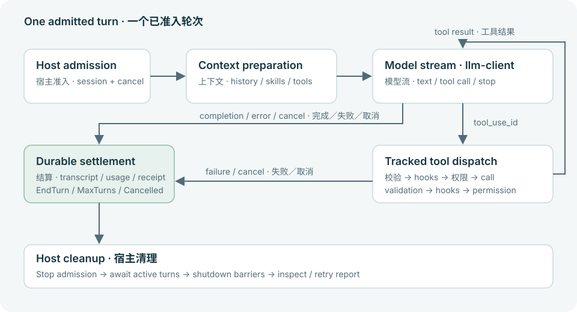

# Agent execution and recovery

Follow one admitted turn from host input to model requests, streamed tool execution and a durable terminal state.

<a id="owners"></a>

## Execution owners

The host admits work and owns the connection, UI and lifetime. Harness/SessionHandle delegates to the mounted SessionService. DesktopRuntime forwards to ConversationOrchestrator; that orchestrator owns conversation mutation, context preparation, permission-aware tool dispatch, compaction and outcome settlement. The subagent runner uses its own context and output ownership while sharing the same tool contracts.

llm-runtime is the Harness-facing model execution adapter. Its ProviderApiAdapter translates host conversation data through the independent llm-client SDK. Provider protocols, network transport and stream decoding remain in llm-client; local tools and host authorization remain in Harness.



A tool result returns to the model loop; cancellation and failures converge on settlement and cleanup.

<a id="prepare"></a>

## Prepare the request context

1. Capture the current session, cancellation token, working directory and resolved model/profile when the host accepts the turn. A later UI selection cannot rewrite the identity of an already-running request.
2. Load applicable instruction memory, command/skill context, session history and host capability reminders. Advertise tools after enablement, session allowlists and provider capability projection.
3. Apply context modifiers and compaction where required, then submit the model request through the SDK boundary. Keep provider credentials and host policy out of model-supplied tool arguments.

Context preparation is not the displayed transcript: hidden instructions, tool references, reminders and compacted summaries can alter the request while persisted visible message identity remains stable.

<a id="stream-tools"></a>

## Stream output and execute tools

The streaming pump accumulates typed HistoryEvent values and checks content-block and terminal boundaries. It emits text and completed assistant rows incrementally. Each tool call retains tool_use_id, canonical name, reassembled JSON input and the original provider call ID. Tool dispatch may begin at a completed tool block while later response blocks continue arriving.

Tracked dispatch validates input, applies hooks and permission policy, schedules concurrency according to the tool contract, and publishes a matching result. The result enters history for the next model request. Message grouping IDs, actual persisted row UUIDs and provider IDs have different roles; preserve each instead of treating them as interchangeable.

- [Tool implementation contract](harness-tools.md)
- [Session storage and identity](session-storage.md)

<a id="stop-recovery"></a>

## Stop, cancel and recover

EndTurn, MaxTurns and Cancelled describe successful control outcomes. A provider, stream, tool or persistence error can instead fail the turn. Stream EOF without a valid completion is not automatically success. Partial output and paired error results are retained where the implemented recovery path permits them.

Prompt-too-long recovery belongs to the orchestration/context layer. The Harness model-service layer drives transient retry over SDK-prepared calls; llm-client owns request encoding and transport, while its prepared dispatch does not replay a turn automatically. Neither recovery path can blindly re-execute a tool that already started. Cancellation unwinds owned work and preserves outcome evidence; it is not proof that external writes were rolled back.

<a id="example-checks"></a>

## Replayable input and acceptance

This is a complete ClientCommand payload for a mounted session, not a Bridge transport envelope. Route events and permission replies through the same connection owner. To exercise the Rust facade without a provider, use the complete lifecycle test in Host lifecycle & persistence.

- Existing tests cover prompt preparation, cancellation at admission, accepted streaming rows, truncated streams, tool pairing and prompt-too-long recovery. Run the scoped orchestrator suite against the baseline under review.
- Live provider streaming, UI ordering during disconnect and irreversible external tool effects require separate host/service acceptance. Source presence and mock success do not establish those results.

### ClientCommand · admitted turn

```json
{
  "type": "send_prompt",
  "text": "Read the project instructions and explain the architecture",
  "images": [],
  "turn_id": 42
}
```

Verification method: API excerpt

## Sources and documentation baseline

[Source repository](https://github.com/lingxi-coder/harness-runtime)

- [harness-runtime/crates/runtime/src/api.rs](https://github.com/lingxi-coder/harness-runtime/blob/1b202fef29353f48026c59712207b89d7d877273/crates/runtime/src/api.rs) — Committed source (1b202fef29353f48026c59712207b89d7d877273)
- [harness-runtime/crates/runtime/src/desktop/sdk.rs](https://github.com/lingxi-coder/harness-runtime/blob/1b202fef29353f48026c59712207b89d7d877273/crates/runtime/src/desktop/sdk.rs) — Committed source (1b202fef29353f48026c59712207b89d7d877273)
- [harness-runtime/crates/orchestrator/src/conversation/drivers/prepare.rs](https://github.com/lingxi-coder/harness-runtime/blob/1b202fef29353f48026c59712207b89d7d877273/crates/orchestrator/src/conversation/drivers/prepare.rs) — Committed source (1b202fef29353f48026c59712207b89d7d877273)
- [harness-runtime/crates/orchestrator/src/conversation/drivers/streaming.rs](https://github.com/lingxi-coder/harness-runtime/blob/1b202fef29353f48026c59712207b89d7d877273/crates/orchestrator/src/conversation/drivers/streaming.rs) — Committed source (1b202fef29353f48026c59712207b89d7d877273)
- [harness-runtime/crates/orchestrator/src/conversation/prompt.rs](https://github.com/lingxi-coder/harness-runtime/blob/1b202fef29353f48026c59712207b89d7d877273/crates/orchestrator/src/conversation/prompt.rs) — Committed source (1b202fef29353f48026c59712207b89d7d877273)
- [harness-runtime/crates/orchestrator/src/streaming_loop.rs](https://github.com/lingxi-coder/harness-runtime/blob/1b202fef29353f48026c59712207b89d7d877273/crates/orchestrator/src/streaming_loop.rs) — Committed source (1b202fef29353f48026c59712207b89d7d877273)
- [harness-runtime/crates/orchestrator/src/streaming_executor.rs](https://github.com/lingxi-coder/harness-runtime/blob/1b202fef29353f48026c59712207b89d7d877273/crates/orchestrator/src/streaming_executor.rs) — Committed source (1b202fef29353f48026c59712207b89d7d877273)
- [harness-runtime/crates/orchestrator/src/turn_loop/tool_dispatch.rs](https://github.com/lingxi-coder/harness-runtime/blob/1b202fef29353f48026c59712207b89d7d877273/crates/orchestrator/src/turn_loop/tool_dispatch.rs) — Committed source (1b202fef29353f48026c59712207b89d7d877273)
- [harness-runtime/crates/orchestrator/src/turn_loop/api_recovery.rs](https://github.com/lingxi-coder/harness-runtime/blob/1b202fef29353f48026c59712207b89d7d877273/crates/orchestrator/src/turn_loop/api_recovery.rs) — Committed source (1b202fef29353f48026c59712207b89d7d877273)
- [harness-runtime/crates/orchestrator/src/provider_adapter.rs](https://github.com/lingxi-coder/harness-runtime/blob/1b202fef29353f48026c59712207b89d7d877273/crates/orchestrator/src/provider_adapter.rs) — Committed source (1b202fef29353f48026c59712207b89d7d877273)
- [harness-runtime/crates/llm-runtime/src/model/retry.rs](https://github.com/lingxi-coder/harness-runtime/blob/1b202fef29353f48026c59712207b89d7d877273/crates/llm-runtime/src/model/retry.rs) — Committed source (1b202fef29353f48026c59712207b89d7d877273)
- [harness-runtime/crates/llm-runtime/src/model/retry_scope.rs](https://github.com/lingxi-coder/harness-runtime/blob/1b202fef29353f48026c59712207b89d7d877273/crates/llm-runtime/src/model/retry_scope.rs) — Committed source (1b202fef29353f48026c59712207b89d7d877273)

- harness-runtime: HEAD 1b202fef29353f48026c59712207b89d7d877273; Referenced input fingerprint sha256:e9079905b280000c8013dd7f16954f3709e464fdcf67fca25de7e73176e1230a; Product pin 1b202fef29353f48026c59712207b89d7d877273

<!-- Generated from apps/web/src/data/docs. Do not edit this file directly. -->
