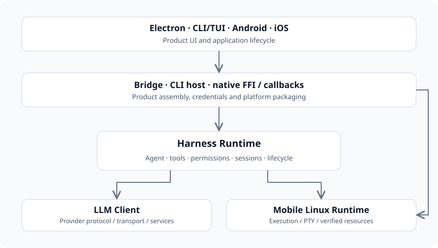

# System architecture & ownership

Follow the product hosts, shared Agent runtime, model SDK and local execution layer, with explicit ownership and implementation boundaries.

## Four independent repositories

The sibling directory is a development convenience. Each repository has its own Git history, dependency lock, build gates and release identity. Product Cargo dependencies choose immutable SDK revisions; the sibling working trees do not automatically override those dependencies.

| Layer | Owns | Consumer contract |
| --- | --- | --- |
| lingxi-app | UI, CLI/TUI, Bridge, native wrappers, callbacks, signing and product resources | SDK facade, shared client DTOs, resource contracts |
| harness-runtime | Agent execution, sessions, tools, permission, sandbox, extension and lifecycle composition | Host-injected services and platform traits |
| llm-client | Provider codecs, connections, transport, normalized streams and service APIs | Requests, prepared calls and provider capabilities |
| mobile-linux-runtime | Linux execution, PTY, resource verification and platform bindings | Runtime API and explicit resource/policy inputs |

Arrows show consumption, not deployment or automatic local dependency substitution.

## Hosts and composition roots

Electron runs the local Rust Bridge and consumes the private TypeScript client. CLI/TUI uses desktop composition directly. Android and iOS use platform-local Rust FFI and native callbacks. The current apps/web application is the public website and SDK documentation with retained prototype screens; it does not establish a deployed browser Agent service.

- [Product & platform integration](platform-integration.md)
- [Harness lifecycle](harness-lifecycle.md)

## Working tree, HEAD and product pin

This handbook describes referenced working-tree files. HEAD identifies the committed base, while the product pin identifies its declared dependency. These can differ. A new file or file whose bytes differ from HEAD has no committed line link; a fingerprint identifies the input bytes but does not make uncommitted code remotely retrievable.

Dependency identity and integration status must be checked separately. Documenting a newer SDK interface does not prove the product is built against it.

## Capabilities and unavailable services

Platform implementations supply filesystem/process/credential/sandbox/device services; the shared Agent owns the workflow. Unsupported capabilities must remain explicit results. Desktop platform code, mobile native execution and hosted model tools have different permission and cancellation owners.

- [Mobile Linux availability and resources](mobile-linux.md)
- [Permissions and sandbox](harness-tools.md)

## Related independent systems

Computer Use and Local App Market have their own architecture and implementation evidence. Their presence in the parent directory is not a dependency edge or proof that every feature is integrated into this product. Use their current documentation and status reports when assessing those projects.

- [Computer Use repository](https://github.com/lingxi-coder/computer-use)
- [Local App Market repository](https://github.com/lingxi-coder/local-app-market)

## Sources and documentation baseline

[Source repository](https://github.com/lingxi-coder/lingxi-app)

- [lingxi-app/Cargo.toml](https://github.com/lingxi-coder/lingxi-app/blob/4c38c5f194b7fd0864d18e2f85e0ae4bd83f7e87/Cargo.toml) — Committed source (4c38c5f194b7fd0864d18e2f85e0ae4bd83f7e87)
- [harness-runtime/crates/runtime/Cargo.toml](https://github.com/lingxi-coder/harness-runtime/blob/f07f87e9a179379e6c429d6143007f979500bd81/crates/runtime/Cargo.toml) — Committed source (f07f87e9a179379e6c429d6143007f979500bd81)
- [harness-runtime/crates/runtime/src/api.rs](https://github.com/lingxi-coder/harness-runtime/blob/f07f87e9a179379e6c429d6143007f979500bd81/crates/runtime/src/api.rs) — Committed source (f07f87e9a179379e6c429d6143007f979500bd81)
- [llm-client/src/lib.rs](https://github.com/lingxi-coder/llm-client/blob/66ce76a2ecc679f0dba551e26ef6aaceb40d2f49/src/lib.rs) — Committed source (66ce76a2ecc679f0dba551e26ef6aaceb40d2f49)
- [mobile-linux-runtime/Cargo.toml](https://github.com/lingxi-coder/mobile-linux-runtime/blob/25cf8a273bcd572b9be48e18fc9807e01dcdfce1/Cargo.toml) — Committed source (25cf8a273bcd572b9be48e18fc9807e01dcdfce1)

- lingxi-app: HEAD 4c38c5f194b7fd0864d18e2f85e0ae4bd83f7e87; Referenced input fingerprint sha256:40b76956c72557655c95a9de37a4fed9d6afad2dc25a52556454f55b9fc0a60a
- harness-runtime: HEAD f07f87e9a179379e6c429d6143007f979500bd81; Referenced input fingerprint sha256:c3dfae4cc5eb31ce91b7b2090c819842f550bbe7ebb0d564931735752ad375b2; Product pin e54f6d018e334dec3153e11d67f8a8224ff538d2
- llm-client: HEAD 66ce76a2ecc679f0dba551e26ef6aaceb40d2f49; Referenced input fingerprint sha256:89fef6f87fb7803bec69d768fa11e408a54f2123d196e2c859d8faba79092d96; Product pin 3cb37e3a3b840b54a4e92994fdc8b1edf7f592d3
- mobile-linux-runtime: HEAD 25cf8a273bcd572b9be48e18fc9807e01dcdfce1; Referenced input fingerprint sha256:3f654be245e2810979441677e37d079538d03bf98bfb68f98d054e4cc79d84df; Product pin 43382a20161e371a0a31526412164b3d35545ab5

<!-- Generated from apps/web/src/data/docs. Do not edit this file directly. -->
