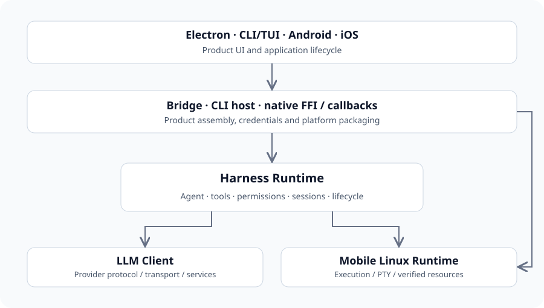

# System architecture & ownership

Follow the product hosts, shared Agent runtime, model SDK and local execution layer, with explicit ownership and implementation boundaries.

## Four independent repositories

The sibling directory is a development convenience. Each repository has its own Git history, dependency lock, build gates and release identity. Product Cargo dependencies choose immutable SDK revisions; the sibling working trees do not automatically override those dependencies.

| Layer | Owns | Consumer contract |
| --- | --- | --- |
| lingxi-app | UI, CLI/TUI, Bridge, native wrappers, callbacks, signing and product resources | SDK facade, shared client DTOs, resource contracts |
| harness-runtime | Agent execution, sessions, tools, permission, sandbox, extension and lifecycle composition | Host-injected services and platform traits |
| llm-client | Provider codecs, connections, transport, normalized streams and service APIs | Requests, prepared calls and provider capabilities |
| mobile-linux-runtime | Linux execution, PTY, resource verification and platform bindings | Runtime API and explicit resource/policy inputs |

Arrows show consumption, not deployment or automatic local dependency substitution.

## Hosts and composition roots

Electron runs the local Rust Bridge and consumes the private TypeScript client. CLI/TUI uses desktop composition directly. Android and iOS use platform-local Rust FFI and native callbacks. The current apps/web application is the public website and SDK documentation with retained prototype screens; it does not establish a deployed browser Agent service.

- [Product & platform integration](platform-integration.md)
- [Harness lifecycle](harness-lifecycle.md)

## Working tree, HEAD and product pin

This handbook describes referenced working-tree files. HEAD identifies the committed base, while the product pin identifies its declared dependency. These can differ. A new file or file whose bytes differ from HEAD has no committed line link; a fingerprint identifies the input bytes but does not make uncommitted code remotely retrievable.

Dependency identity and integration status must be checked separately. Documenting a newer SDK interface does not prove the product is built against it.

## Capabilities and unavailable services

Platform implementations supply filesystem/process/credential/sandbox/device services; the shared Agent owns the workflow. Unsupported capabilities must remain explicit results. Desktop platform code, mobile native execution and hosted model tools have different permission and cancellation owners.

- [Mobile Linux availability and resources](mobile-linux.md)
- [Permissions and sandbox](harness-tools.md)

## Related independent systems

Computer Use and Local App Market have their own architecture and implementation evidence. Their presence in the parent directory is not a dependency edge or proof that every feature is integrated into this product. Use their current documentation and status reports when assessing those projects.

- [Computer Use repository](https://github.com/lingxi-coder/computer-use)
- [Local App Market repository](https://github.com/lingxi-coder/local-app-market)

## Sources and documentation baseline

[Source repository](https://github.com/lingxi-coder/lingxi-app)

- lingxi-app/Cargo.toml — Unpublished source (90a626b807a57c06a984bcd117bb03235aa6e0e5)
- [harness-runtime/crates/runtime/Cargo.toml](https://github.com/lingxi-coder/harness-runtime/blob/f50814ec8381f10756f66eadf457474d90bcc69a/crates/runtime/Cargo.toml) — Committed source (f50814ec8381f10756f66eadf457474d90bcc69a)
- [harness-runtime/crates/runtime/src/api.rs](https://github.com/lingxi-coder/harness-runtime/blob/f50814ec8381f10756f66eadf457474d90bcc69a/crates/runtime/src/api.rs) — Committed source (f50814ec8381f10756f66eadf457474d90bcc69a)
- [llm-client/src/lib.rs](https://github.com/lingxi-coder/llm-client/blob/63c8f7663b7cba7466538213f86c6df4a30442a9/src/lib.rs) — Committed source (63c8f7663b7cba7466538213f86c6df4a30442a9)
- [mobile-linux-runtime/Cargo.toml](https://github.com/lingxi-coder/mobile-linux-runtime/blob/5dd627e1049ba85e0563b7f351f79b00267c58c3/Cargo.toml) — Committed source (5dd627e1049ba85e0563b7f351f79b00267c58c3)

- lingxi-app: HEAD 90a626b807a57c06a984bcd117bb03235aa6e0e5; Referenced input fingerprint sha256:0414ded61011432be634176b81ab5e5d501536ae723505b952a4b31c1b32bd78
- harness-runtime: HEAD f50814ec8381f10756f66eadf457474d90bcc69a; Referenced input fingerprint sha256:6fe1d28e55bd5b9d72e3fe6ee54f892c7efe64b640840a407ccee12dcef85567; Product pin f50814ec8381f10756f66eadf457474d90bcc69a
- llm-client: HEAD 63c8f7663b7cba7466538213f86c6df4a30442a9; Referenced input fingerprint sha256:c333c57f017ceb83b75e77ac252dc2cf3850ac8a74a5199f5d9154b7e698100c; Product pin 63c8f7663b7cba7466538213f86c6df4a30442a9
- mobile-linux-runtime: HEAD 5dd627e1049ba85e0563b7f351f79b00267c58c3; Referenced input fingerprint sha256:5dd456cd771483f341bb99d25aff43140c96f893f6de5541c381c2083f162064; Product pin 5dd627e1049ba85e0563b7f351f79b00267c58c3

<!-- Generated from apps/web/src/data/docs. Do not edit this file directly. -->
