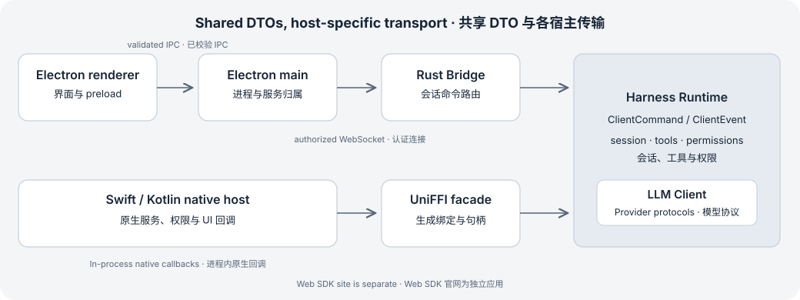

# TypeScript Bridge 客户端

将 Node.js 宿主连接到本地 LingXi Bridge 服务，提交命令、消费事件并处理权限请求。

<a id="integration-boundary"></a>

## 选择此集成方式

Bridge 客户端是产品仓库内的私有 TypeScript 包，导出协议 DTO、lockfile 发现、校验工具及 Node 端 WebSocket 客户端。Electron 通过本地 file 依赖消费编译后的 dist 导出。

BridgeClient 依赖 node:events 和 ws，应运行在 Node.js 或 Electron 宿主进程中；浏览器应用需要对应的宿主传输层。它不提供托管 LLM HTTP API，也没有公开 npm 安装契约。

### 从产品 checkout 构建

```bash
cargo build --locked -p bridge-server --bin bridge-server
npm --prefix packages/bridge-client ci
npm --prefix packages/bridge-client run build
```

验证方式: 接口摘录

### 本地包依赖

```json
{
  "dependencies": {
    "@lingxi/bridge-client": "file:../../packages/bridge-client"
  }
}
```

验证方式: 接口摘录

构建命令从产品仓库根目录执行。上面的 file 路径相对于 apps/electron/package.json，其他本地消费者需调整路径；连接前先通过产品宿主启动 Bridge 服务。

<a id="connect-and-stream"></a>

## 连接并接收回合事件

未指定 lockfilePath 或 lockfileDir 时，connect() 从 ~/.lingxi/bridge 发现 lockfile。它使用 mcp 子协议连接 ws://127.0.0.1:<port>/mcp，通过 X-LingXi-Ide-Authorization 携带 lockfile token，再交换 hello 消息并检查协议兼容性。

sendPrompt() 提交命令后立即返回，不等待回合结果。文本、工具活动与最终回合结果通过 ClientEvent 到达。应在连接或提交之前调用 events() 订阅，只有已订阅的迭代器才会保留入站事件。示例拒绝权限与电脑访问请求，并取消问卷，以处理无人值守交互；产品宿主应展示请求并应用用户决定。

### Node.js／TypeScript 消费者

```typescript
import { BridgeClient } from '@lingxi/bridge-client';

const client = new BridgeClient({ clientName: 'documentation-example' });
const events = client.events();
client.on('error', (error: Error) => console.error(error.message));
client.on('permission', (request) => {
  client.denyPermission(request.request_id);
});
client.on('computerAccess', (request) => {
  client.denyComputerAccess(request.request_id);
});

try {
  await client.connect();
  client.sendPrompt('Describe the repository structure without changing files.');

  for await (const event of events) {
    if (event.type === 'ask_user_question') client.cancelAskUserQuestion(event.request.request_id);
    if (event.type === 'text_delta') process.stdout.write(event.text);
    if (event.type === 'turn_ended') {
      console.log(event.outcome, event.cost);
      break;
    }
  }
} finally {
  await events.return?.();
  client.close();
}
```

验证方式: 编译检查 (bridge-command-events)

<a id="client-api"></a>

## 连接与命令 API

### BridgeClient

```typescript
new BridgeClient(opts: BridgeClientOptions = {})
```

配置 lockfilePath、lockfileDir、host、clientName、audioCapabilities 与 handshakeTimeoutMs；默认握手超时为 10,000 ms。

### connect

```typescript
connect(): Promise<ServerHello>
```

建立已认证连接并完成版本握手，然后才能发送命令。

### sendPrompt

```typescript
sendPrompt(text: string, opts: { images?: ImageRefDto[]; turnId?: number; visualizationContext?: VisualizationRefDto } = {}): void
```

提交文本、内联 media_type/base64 图片、可选的调用方回合标识及可视化上下文。

### sendCommand

```typescript
sendCommand(command: ClientCommand): void
```

发送类型化协议命令；未连接或消息帧过大时，会在发送前抛出错误。

### cancel

```typescript
cancel(turnId?: number): void
```

取消当前回合，或通过标识取消指定回合。

### events

```typescript
events(): AsyncIterableIterator<ClientEvent>
```

立即订阅并按顺序消费事件直到关闭。订阅前的事件不会重放；所有迭代器共享一个队列并分配事件。最后一个迭代器 return 会释放缓冲；openai_oauth_updated 仅交给宿主事件监听器。

### close

```typescript
close(): void
```

关闭底层 WebSocket；在命令和事件的完整生命周期内保留客户端。

<a id="permissions"></a>

## 权限与交互请求

权限请求与电脑访问请求通过独立监听事件到达。使用各自的 request_id 关联响应；普通事件流不能替代权限监听器，应在提交首个提示前注册监听。

### approvePermission / denyPermission

```typescript
approvePermission(requestId: number, response: PermissionResponseDto = { type: "allow_once" }): void
denyPermission(requestId: number): void
```

处理等待中的工具权限请求；需要更广的授权语义时，显式传入对应响应。

### approveComputerAccess / denyComputerAccess

```typescript
approveComputerAccess(requestId: number, response: ComputerAccessResponseDto): void
denyComputerAccess(requestId: number): void
```

独立处理电脑工具的访问请求，与普通工具权限分开关联。

### answerAskUserQuestion / cancelAskUserQuestion

```typescript
answerAskUserQuestion(requestId: number, answers: Record<string, string>): void
cancelAskUserQuestion(requestId: number): void
```

为交互问卷返回按键组织的答案集合，或取消等待中的请求。

<a id="wire-handshake"></a>

## 传输契约与版本握手

当前工作树常量为 BRIDGE_PROTOCOL_VERSION = 0.2.0、CLIENT_PROTOCOL_VERSION = 29.0.0。Rust 是契约来源，TypeScript DTO 文件镜像该契约。传输包与 DTO 分别校验，双方数字主版本须各自相同。格式错误或版本不匹配会拒绝 hello 并阻止后续命令；服务端 hello 拒绝使用传输错误码 -32600。

Frame 使用 type/payload 邻接标签；ClientCommand 与 ClientEvent 使用内部 type 标签及 snake_case 值。可选字段可能不存在。工具 input_json/result_json 保持 JSON 字符串形式，客户端须显式解析内容，不能把传输表示改成对象。mcp 路径／子协议名称不表示产品命令就是普通 MCP tools/list 或 tools/call 请求。

1. 宿主启动本地服务，并写入含 authToken 的受保护 <port>.lock。
2. 客户端为目标会话选择明确 lockfile，发送认证头并请求 mcp WebSocket 升级。
3. 客户端发送 request/hello；服务端校验两个主版本并返回 ServerHello。
4. connect 完成后，宿主才能提交命令并消费事件／交互请求。



传输分帧与共享 ClientCommand／ClientEvent 契约分离。

### 当前 hello 请求形状

```json
{
  "type": "request",
  "payload": {
    "id": 1,
    "method": "hello",
    "params": {
      "protocol_version": "0.2.0",
      "client_name": "documentation-example",
      "capabilities": {
        "supports_streaming": true,
        "supports_tools": true,
        "supports_skills": true,
        "supports_commands": true,
        "client_protocol_version": "29.0.0"
      }
    }
  }
}
```

验证方式: 接口摘录

<a id="correlation-and-errors"></a>

## 关联、错误与连接销毁

出站 frame id 关联请求／响应传输包，与 turn_id、session_id 或 broker request_id 不同。sendCommand/sendPrompt 只负责提交，其请求 ID 不注册为等待响应；完成通过 turn_ended 等 ClientEvent 到达。通过事件响应的产品操作须用载荷请求标识与会话身份共同关联；SessionEventCorrelator 拒绝重复请求、对缺失响应超时，并可拒绝已销毁会话。

区分三个失败接口：BridgeWireError 是带数字 code/message 的传输响应；流式 ClientEvent.error 报告已接受操作中的运行时故障；ClientError 是原生 submit 调用结果错误，分为 transport/protocol/rejected/not_found/internal。发送或原生 submit 成功不代表模型回合成功；应等待终态结果，并保留不含认证 token 或 provider 凭证的诊断上下文。

端点每帧最多读取 16 MiB。BridgeClient 在发送前检查序列化帧的 UTF-8 字节数，避免过大的提示、图片或音频响应影响整个连接。Socket 关闭会拒绝等待中的传输请求并结束订阅迭代器。服务端连接清理会取消归属回合及 broker 工作；宿主重连须恢复持久会话状态、清除旧等待交互，不能自动重放结果不确定的命令。

| 标识 | 归属／用途 |
| --- | --- |
| Frame.payload.id | 一个连接内的请求／响应交换。 |
| session_id | 持久会话与运行时归属。 |
| turn_id | 单个回合与定向取消；字段可能可选。 |
| 权限／问卷 request_id | 待处理交互 broker 请求，单次回答。 |
| AudioOperationIdDto | 完整 id + generation + service_epoch 身份。 |

<a id="bridge-validation"></a>

## 集成验证与排障

产品包测试覆盖握手拒绝、帧限制、非法入站 DTO、事件迭代器归属、电脑访问和问卷关联。修改共享契约前应运行这些检查。源码索引定位声明；协议 fixture 与 Rust round-trip 测试验证序列化行为，不能证明远程服务、真实音频设备或真实 provider 验收。

没有 lockfile 表示目标服务无法发现；HTTP 401 表示升级 token 不匹配；hello 不兼容表示服务端／客户端构建不匹配；回合没有事件可能是迭代器订阅过晚，或权限／问卷仍在等待。多会话应使用宿主提供的明确 lockfilePath，不能假定最近修改文件就是目标会话。不要把 lockfile authToken 复制到网页、示例仓库或诊断报告。

### Bridge 包与协议检查

```bash
npm --prefix packages/bridge-client run build
npm --prefix packages/bridge-client test
cargo test --locked -p bridge --test protocol_roundtrip_test
```

验证方式: 需环境验证

- [桌面生命周期](desktop-host.md)
- [原生回调集成](platform-integration.md)

## 源码与文档基线

[源码仓库](https://github.com/lingxi-coder/lingxi-app/tree/main/packages/bridge-client)

- [lingxi-app/packages/bridge-client/src/client.ts](https://github.com/lingxi-coder/lingxi-app/blob/caf679253971034bc202c566a81c10d4c5af31c4/packages/bridge-client/src/client.ts) — 已提交源码 (caf679253971034bc202c566a81c10d4c5af31c4)
- [lingxi-app/packages/bridge-client/src/protocol.ts](https://github.com/lingxi-coder/lingxi-app/blob/caf679253971034bc202c566a81c10d4c5af31c4/packages/bridge-client/src/protocol.ts) — 已提交源码 (caf679253971034bc202c566a81c10d4c5af31c4)
- [lingxi-app/packages/bridge-client/src/version.ts](https://github.com/lingxi-coder/lingxi-app/blob/caf679253971034bc202c566a81c10d4c5af31c4/packages/bridge-client/src/version.ts) — 已提交源码 (caf679253971034bc202c566a81c10d4c5af31c4)
- [lingxi-app/packages/bridge-client/src/lockfile.ts](https://github.com/lingxi-coder/lingxi-app/blob/caf679253971034bc202c566a81c10d4c5af31c4/packages/bridge-client/src/lockfile.ts) — 已提交源码 (caf679253971034bc202c566a81c10d4c5af31c4)
- [lingxi-app/packages/bridge-client/src/eventCorrelation.ts](https://github.com/lingxi-coder/lingxi-app/blob/caf679253971034bc202c566a81c10d4c5af31c4/packages/bridge-client/src/eventCorrelation.ts) — 已提交源码 (caf679253971034bc202c566a81c10d4c5af31c4)
- [lingxi-app/apps/bridge-server/src/server.rs](https://github.com/lingxi-coder/lingxi-app/blob/caf679253971034bc202c566a81c10d4c5af31c4/apps/bridge-server/src/server.rs) — 已提交源码 (caf679253971034bc202c566a81c10d4c5af31c4)
- [lingxi-app/apps/bridge-server/src/router.rs](https://github.com/lingxi-coder/lingxi-app/blob/caf679253971034bc202c566a81c10d4c5af31c4/apps/bridge-server/src/router.rs) — 已提交源码 (caf679253971034bc202c566a81c10d4c5af31c4)
- [harness-runtime/crates/bridge/src/wire.rs](https://github.com/lingxi-coder/harness-runtime/blob/f975ab5804bb3af0e72beb3974e5c911ece44d53/crates/bridge/src/wire.rs) — 已提交源码 (f975ab5804bb3af0e72beb3974e5c911ece44d53)
- [harness-runtime/crates/bridge/src/mcp_endpoint.rs](https://github.com/lingxi-coder/harness-runtime/blob/f975ab5804bb3af0e72beb3974e5c911ece44d53/crates/bridge/src/mcp_endpoint.rs) — 已提交源码 (f975ab5804bb3af0e72beb3974e5c911ece44d53)
- [harness-runtime/crates/client/src/protocol/commands.rs](https://github.com/lingxi-coder/harness-runtime/blob/f975ab5804bb3af0e72beb3974e5c911ece44d53/crates/client/src/protocol/commands.rs) — 已提交源码 (f975ab5804bb3af0e72beb3974e5c911ece44d53)
- [harness-runtime/crates/client/src/protocol/events.rs](https://github.com/lingxi-coder/harness-runtime/blob/f975ab5804bb3af0e72beb3974e5c911ece44d53/crates/client/src/protocol/events.rs) — 已提交源码 (f975ab5804bb3af0e72beb3974e5c911ece44d53)
- [harness-runtime/crates/client/src/protocol/error.rs](https://github.com/lingxi-coder/harness-runtime/blob/f975ab5804bb3af0e72beb3974e5c911ece44d53/crates/client/src/protocol/error.rs) — 已提交源码 (f975ab5804bb3af0e72beb3974e5c911ece44d53)

- lingxi-app: HEAD caf679253971034bc202c566a81c10d4c5af31c4; 所据文件指纹 sha256:5172e409e969106eb5149a400160fbc916294195f79f186ce9f63e32444c54b5
- harness-runtime: HEAD f975ab5804bb3af0e72beb3974e5c911ece44d53; 所据文件指纹 sha256:92c2108dc63215bc69ea9c11ea081795da883fdcb1c9c28b060aa9221a1b95a2; 产品固定版本 e04c1837508014d68ea042d5c9fe3c8c15af5aa0

<!-- Generated from apps/web/src/data/docs. Do not edit this file directly. -->
