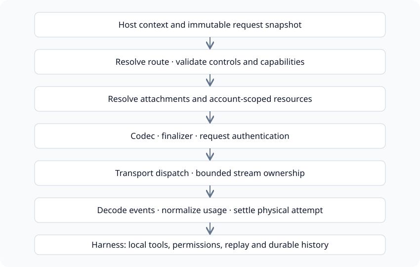

# 请求与执行

构建类型化模型输入，通过草稿、准备、发送与收集阶段控制每一次实际调用。

<a id="chat-request"></a>

## ChatRequest

ChatRequest::new(model) 创建空对话与默认可选控制项。用 ConversationMessage 和 ContentBlock 填入消息。system 表示系统块，tools 与 tool_choice 表示函数工具，hosted_tools 表示供应商执行的工具，output_format 表示输出约束。

controls 承载显式协议控制项；thinking 与 service_tier 按所选模型和协议校验。continuation 绑定原账户、端点、连接与模型。重放助手消息时必须保留原生内容和签名。

### Typed input · excerpt / 类型化输入片段

```rust
use lingxi_llm_client::protocol::{ChatRequest, ConversationMessage};

let mut request = ChatRequest::new("gpt-4.1-mini");
request.messages.push(ConversationMessage::user_text("Explain ownership in Rust."));
request.max_tokens = Some(1024);
```

验证方式: 接口摘录

### ChatRequest::new

```text
pub fn new(model: impl Into<String>) -> Self
```

创建尚未填入对话或可选覆盖项的模型输入。

### ConversationMessage::user_text

```text
pub fn user_text(text: impl Into<String>) -> Self
```

创建包含一个纯文本块的用户消息。

### ChatService::complete_in

```text
pub async fn complete_in(self, profile: &str, request: &ChatRequest, options: &RequestOptions) -> Result<ChatResponse, LlmError>
```

显式选择起始连接。complete() 则根据模型解析路由。

<a id="request-options"></a>

## RequestOptions

- credential 为主连接提供认证。fallback_credentials 为指定备用连接提供独立凭据；主密钥不会隐式转发。
- account_scope 是用于续接的稳定非敏感身份。file_account_scope 独立限定可复用的供应商上传文件。
- total_timeout 限制准备与响应读取的总时间。普通生成默认 120 秒，含视频为两小时；流式请求默认没有总时限。
- finalizer 在编码后、认证前同步应用宿主策略；不得在此发送请求或获取凭据。

<a id="prepared-call"></a>

## 一次准备，一次发送

prepare_on 必须接收精确连接名，固定该连接的模型行并认证请求。准备过程可能上传附件，但不会发送生成请求。PreparedCall 不可变且不可克隆；发送操作会消耗它。重试或切换连接必须重新准备。

### Host execution · excerpt with existing client/request/options / 宿主执行片段

```rust
use lingxi_llm_client::codecs::RequestMode;

let snapshot = client.snapshot();
let call = snapshot.prepare_on("openai", &request, &options, RequestMode::Complete).await?;
let prices = call.pricing_snapshot();
let received = call.dispatch_once().await?;
let collected = received.collect().await?;
let usage = collected.usage_report().clone();
let inference = collected.inference_report().clone();
let answer = collected.decode();
collected.finish().await;
let response = answer?;
```

验证方式: 接口摘录

### ClientSnapshot::prepare_on

```text
pub async fn prepare_on(&self, profile: &str, request: &ChatRequest, options: &RequestOptions, mode: RequestMode) -> Result<PreparedCall, LlmError>
```

使用保留的配置快照为精确连接准备一次调用。

### PreparedCall::pricing_snapshot

```text
pub fn pricing_snapshot(&self) -> FrozenPricing
```

在消耗调用前保留所选价格，供取消等路径使用。

### PreparedCall::dispatch_once

```text
pub async fn dispatch_once(self) -> Result<ReceivedCall, LlmError>
```

最多发送一次生成请求，不进行重试或连接回退。

### ReceivedCall::collect

```text
pub async fn collect(self) -> Result<CollectedResponse, LlmError>
```

在解析应用输出前收集原始响应与结算事实。

在 decode() 前保留用量与推理报告：失败状态或不合法的工具 JSON 仍可能携带结算观测。宿主决定如何持久化事实，并调用 finish() 完成附件清理。

<a id="draft-admission"></a>

## 草稿与宿主准入

### ClientSnapshot::prepare_draft_on

```text
pub async fn prepare_draft_on(&self, profile: &str, request: &ChatRequest, options: &RequestOptions, mode: RequestMode) -> Result<RequestDraft, LlmError>
```

解析与编码请求，但不对生成请求签名。草稿仅使用显式提供的总超时。

### RequestDraft::request_mut

```text
pub fn request_mut(&mut self) -> &mut HttpRequest
```

在认证前应用最终的宿主请求修改。

### RequestDraft::seal

```text
pub async fn seal(self) -> Result<PreparedCall, LlmError>
```

认证最终字节并消耗草稿。草稿不能直接发送。

### PreparedCall::dispatch_once_with

```text
pub async fn dispatch_once_with(self, on_dispatch: impl FnOnce() -> Result<(), LlmError> + Send) -> Result<ReceivedCall, LlmError>
```

发送前立即运行同步准入标记；拒绝时不会发送。

### LlmClient::count_tokens_exact_in

```text
pub async fn count_tokens_exact_in(&self, profile: &str, request: &ChatRequest, options: &RequestOptions) -> Result<Option<u64>, LlmError>
```

使用 Anthropic 精确输入计数。不支持的协议返回 None；计数错误仍为错误，且不会生成回答。

<a id="wire-pipeline"></a>

## 类型化输入到传输

1. 捕获配置，解析模型、连接、区域与协议，检查显式控制、续接、托管工具与文件约束。
2. 解析宿主附件，选择内联/供应商文件绑定并捕获请求级文件来源。生成预检可能执行附件 I/O 与上传。
3. WireCodec 使用 CodecContext/EncodeRequest 编码所选协议，应用宿主 finalizer 并对最终字节认证一次。
4. Transport 返回状态、响应头与原始响应体流。非流式先收集再解码；流式按传输块使用 codec decoder 与结算观测。
5. 返回标准内容、用量、推理事实与作用域续接。宿主执行本地工具、持久化转录、选择下一轮并清理资源。



SDK 负责供应商通信；Harness 负责工具执行、权限、历史与逐次结算。

请求准入失败可能发生于传输前；响应解析失败可能发生于供应商已接受并收费后。不能以 JSON 解码成功作为记录实际尝试的边界。

<a id="input-replay"></a>

## 工具、原生内容与续接

ConversationMessage 携带标准 ContentBlock 与协议标记 native_options。文本、思考、签名、工具 ID 与精确工具参数 JSON 具有不同重放职责。ProviderContent 属于原协议，不兼容重放会拒绝；原始 ProviderEvent 观测不是转录内容。

仅在 account_scope 稳定时，完成响应产生可复用 ContinuationRef。下一次请求携带该引用与新输入，必须使用原实际执行连接、端点、模型与账户；单独 raw response_id 不是可移植续接。

- [逐次结算与重试策略](llm-execution-accounting.md)
- [附件与供应商文件](llm-files.md)

## 源码与文档基线

[源码仓库](https://github.com/lingxi-coder/llm-client)

- [llm-client/src/client/options.rs](https://github.com/lingxi-coder/llm-client/blob/179d336607b2367cf0709a78c760c9333ec25bb3/src/client/options.rs) — 已提交源码 (179d336607b2367cf0709a78c760c9333ec25bb3)
- [llm-client/src/client/prepared.rs](https://github.com/lingxi-coder/llm-client/blob/179d336607b2367cf0709a78c760c9333ec25bb3/src/client/prepared.rs) — 已提交源码 (179d336607b2367cf0709a78c760c9333ec25bb3)
- [llm-client/src/client/executor.rs](https://github.com/lingxi-coder/llm-client/blob/179d336607b2367cf0709a78c760c9333ec25bb3/src/client/executor.rs) — 已提交源码 (179d336607b2367cf0709a78c760c9333ec25bb3)
- [llm-client/src/client/requests.rs](https://github.com/lingxi-coder/llm-client/blob/179d336607b2367cf0709a78c760c9333ec25bb3/src/client/requests.rs) — 已提交源码 (179d336607b2367cf0709a78c760c9333ec25bb3)
- [llm-client/src/protocol/llm.rs](https://github.com/lingxi-coder/llm-client/blob/179d336607b2367cf0709a78c760c9333ec25bb3/src/protocol/llm.rs) — 已提交源码 (179d336607b2367cf0709a78c760c9333ec25bb3)
- [llm-client/src/codecs/mod.rs](https://github.com/lingxi-coder/llm-client/blob/179d336607b2367cf0709a78c760c9333ec25bb3/src/codecs/mod.rs) — 已提交源码 (179d336607b2367cf0709a78c760c9333ec25bb3)
- [llm-client/src/transport.rs](https://github.com/lingxi-coder/llm-client/blob/179d336607b2367cf0709a78c760c9333ec25bb3/src/transport.rs) — 已提交源码 (179d336607b2367cf0709a78c760c9333ec25bb3)
- [llm-client/tests/execution_contracts.rs](https://github.com/lingxi-coder/llm-client/blob/179d336607b2367cf0709a78c760c9333ec25bb3/tests/execution_contracts.rs) — 已提交源码 (179d336607b2367cf0709a78c760c9333ec25bb3)

- llm-client: HEAD 179d336607b2367cf0709a78c760c9333ec25bb3; 所据文件指纹 sha256:64423ae6bcb4985bab0883b693378509bb7fe060e59bf4facafedcb4d2f32293; 产品固定版本 450d52b12b6d88a377ab3332c3b8a6a1820e2b7c

<!-- Generated from apps/web/src/data/docs. Do not edit this file directly. -->
