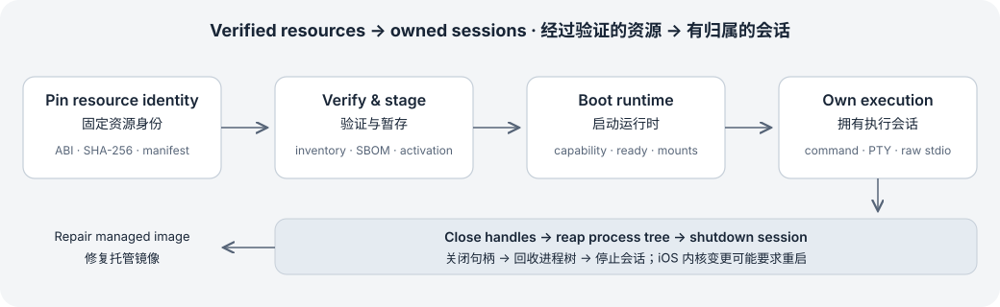

# 移动 Linux 运行时

在 Android 与 iOS 应用内嵌入 Linux 用户空间，提供命令、流式输出、PTY、原始标准输入输出与经过校验的 rootfs 生命周期。

<a id="platforms"></a>

## 支持的平台

Mobile Linux Runtime 是独立 SDK。应用负责提供路径、经过校验的 rootfs 资源、挂载与网络策略，以及生命周期。Rust 契约与平台后端不依赖 Harness、Agent、LLM 或应用偏好设置。

- Android：PRoot 后端；arm64-v8a 与 x86_64；应用最低 API 26。可选的旧版宿主 shell 辅助接口要求 API 29。
- iOS：真机使用 iSH arm64 后端；最低 iOS 18.0。arm64 与 x86_64 模拟器切片用于链接和 API 集成检查，不能执行 guest 命令。

<a id="integration-mode"></a>

## 选择接入方式

- Kotlin 应用使用 mobile-linux-runtime，以及传递依赖的 installer 和 native-support AAR。Swift 应用选择 MobileLinuxRuntime 产品，它链接 FFI 与 native-support XCFramework。
- 已嵌入 Rust 的应用使用同一个 Git 修订版本的 SDK Rust crates 与仅含原生支持的产物。Android 还需 mobile-linux-installer；iOS 选择 MobileLinuxNativeSupport。
- 进程内保留一份 Rust 运行时。native-support 分发包含平台桥接与辅助程序，不包含第二份 Rust 库。

<a id="prerequisites"></a>

## 构建前提

源码构建固定 Rust 1.94.0，并要求 Python 3.12 或更新版本。Android 使用 Gradle wrapper、JDK 21、SDK platform 37、NDK 27.2.12479018 与 cargo-ndk 4.1.2。iOS 需要 macOS、带 iOS SDK 的 Xcode、Meson 与 Ninja；SwiftPM 封装使用 Swift tools 5.9。

从 SDK 仓库根目录运行源码检查。SDK_BUILD_DIR 必须是源码检出目录以外、由调用方拥有的绝对路径；SDK 不要求相邻的应用或 Harness 仓库。

### 源码检查摘录

```bash
: "${SDK_BUILD_DIR:?Set an absolute directory outside the source checkout}"
export CARGO_TARGET_DIR="$SDK_BUILD_DIR/rust"
cargo test --locked -p mobile-linux-api -p mobile-linux-core -p platform-pty
bash scripts/checks/check-dependencies.sh
bash scripts/checks/check-resource-contracts.sh
bash scripts/checks/check-resource-tests.sh
```

验证方式: 接口摘录

<a id="runtime-handle"></a>

## 创建持久运行时句柄

UniFFI 命名空间为 mobile_linux_runtime。Kotlin 与 Swift 通过 MobileLinuxRuntime 封装暴露 RuntimeHandle。任务、PTY 或 raw-stdio 句柄仍在使用时，必须保留运行时对象。

### 配置声明摘录

```rust
pub struct RuntimeConfig {
    pub platform: RuntimePlatform,
    pub managed_root: String,
    pub app_sandbox_root: String,
    pub abi: String,
    pub rootfs_version: String,
    pub archive_sha256: Option<String>,
    pub native_library_dir: Option<String>,
    pub workspace_host_path: Option<String>,
    pub stable_workspace_id: Option<String>,
    pub authorization_file: Option<String>,
    pub rootfs_archive_path: Option<String>,
    #[uniffi(default = None)]
    pub rootfs_patch_path: Option<String>,
    pub default_mount_path: Option<String>,
    pub protected_host_roots: Vec<String>,
    pub allowed_mount_roots: Vec<String>,
    pub allowed_guest_roots: Vec<String>,
}
```

验证方式: 接口摘录

### create_runtime

```text
pub fn create_runtime(config: RuntimeConfig) -> Result<Arc<RuntimeHandle>, MobileLinuxApiErrorFfi>
```

创建平台运行时。managed_root 与 app_sandbox_root 必须是绝对路径；ABI 与 rootfs 版本不能为空。iOS 还要求 workspace_host_path 和 stable_workspace_id。

<a id="rootfs-lifecycle"></a>

## 经过校验的 rootfs 生命周期

rootfs 压缩包是调用方单独提供的输入，SDK 不会静默下载或内置它们。独立固定压缩包 SHA-256，并提供匹配的 manifest 与 SBOM。Android 先暂存经验证的 tar.gz，再 repair 和 boot；iOS 使用转换后的 iSH fakefs ZIP 与显式资源路径。

### RuntimeHandle::status

```text
pub async fn status(&self) -> Result<MobileLinuxStatusFfi, MobileLinuxApiErrorFfi>
```

读取 rootfs 生命周期快照、版本、路径与最近错误。

### RuntimeHandle::verify_rootfs

```text
pub async fn verify_rootfs(&self) -> Result<MobileLinuxStatusFfi, MobileLinuxApiErrorFfi>
```

重新计算完整性并返回当前状态。

### RuntimeHandle::repair_rootfs

```text
pub async fn repair_rootfs(&self) -> Result<MobileLinuxStatusFfi, MobileLinuxApiErrorFfi>
```

尝试非破坏性修复；Android 会激活有效的暂存镜像。

### RuntimeHandle::reset_rootfs

```text
pub async fn reset_rootfs(&self) -> Result<MobileLinuxStatusFfi, MobileLinuxApiErrorFfi>
```

重置托管 rootfs 状态并保留外部用户数据；已启动的 iOS 内核可能返回 RestartRequired。

<a id="release-identity"></a>

## 发布产物身份

使用对应发布版本的 checksums 与 release-provenance.json。源码构建成功、压缩包存在或模拟器链接成功，不等同于真机验收。validation-only 产物不属于发布产物。

<a id="lifecycle-flow"></a>

## 安装与会话流程

rootfs 身份由嵌入应用决定。版本标签描述预期镜像，不能替代压缩包摘要、manifest 文件清单或平台 ABI。不可变镜像资源应与可写工作区和 guest home 分离；宿主准入请求后，由运行时拥有执行句柄。

boot 建立可执行状态，verify 显式刷新完整性。status 读取是诊断数据；repair 与 reset 是明确的生命周期操作。应用应展示返回的状态及 last_error、保留用户工作区，并只对托管镜像执行修复。

1. 获取平台资源包，固定其压缩包摘要与修订版本。
2. 暂存并验证 rootfs；用应用私有绝对路径创建 RuntimeConfig。
3. 保留运行时，检查 capability 并 boot，再执行命令或打开会话。
4. 消费输出及终态；在 shutdown 前关闭 PTY、raw stdio 与后台句柄。



修复针对托管 rootfs；iOS 进程级内核变更可能要求重启。

<a id="validation-levels"></a>

## 实现、证据与开放验收

公共 trait、UniFFI 句柄及 Kotlin/Swift 包装实现本页接入接口。源码仓库包含单元／契约检查和真机 smoke 应用；文档命令提供可重复验证方法，不表示已经在所有受支持设备上执行。

新分发版本仍须验收压缩包损坏与恢复、ABI 打包、权限拒绝、网络／内存约束、进程树取消及真机 guest 执行。模拟器仅用于 API 和链接测试。

- [可移植 Rust 契约](mobile-rust.md)
- [挂载、网络与 rootfs 策略](mobile-authorization.md)
- [产品原生宿主](platform-integration.md)

## 源码与文档基线

[源码仓库](https://github.com/lingxi-coder/mobile-linux-runtime/tree/main/Cargo.toml)

- [mobile-linux-runtime/Cargo.toml](https://github.com/lingxi-coder/mobile-linux-runtime/blob/6b033d41a2b6b736fda1e8f996f55a4b20bd885d/Cargo.toml) — 已提交源码 (6b033d41a2b6b736fda1e8f996f55a4b20bd885d)
- [mobile-linux-runtime/rust-toolchain.toml](https://github.com/lingxi-coder/mobile-linux-runtime/blob/6b033d41a2b6b736fda1e8f996f55a4b20bd885d/rust-toolchain.toml) — 已提交源码 (6b033d41a2b6b736fda1e8f996f55a4b20bd885d)
- [mobile-linux-runtime/crates/mobile-linux-ffi/src/runtime.rs](https://github.com/lingxi-coder/mobile-linux-runtime/blob/6b033d41a2b6b736fda1e8f996f55a4b20bd885d/crates/mobile-linux-ffi/src/runtime.rs) — 已提交源码 (6b033d41a2b6b736fda1e8f996f55a4b20bd885d)
- [mobile-linux-runtime/crates/mobile-linux-ffi/src/types.rs](https://github.com/lingxi-coder/mobile-linux-runtime/blob/6b033d41a2b6b736fda1e8f996f55a4b20bd885d/crates/mobile-linux-ffi/src/types.rs) — 已提交源码 (6b033d41a2b6b736fda1e8f996f55a4b20bd885d)
- [mobile-linux-runtime/android/runtime/build.gradle.kts](https://github.com/lingxi-coder/mobile-linux-runtime/blob/6b033d41a2b6b736fda1e8f996f55a4b20bd885d/android/runtime/build.gradle.kts) — 已提交源码 (6b033d41a2b6b736fda1e8f996f55a4b20bd885d)
- [mobile-linux-runtime/ios/Package.swift](https://github.com/lingxi-coder/mobile-linux-runtime/blob/6b033d41a2b6b736fda1e8f996f55a4b20bd885d/ios/Package.swift) — 已提交源码 (6b033d41a2b6b736fda1e8f996f55a4b20bd885d)
- [mobile-linux-runtime/scripts/checks/check-resource-contracts.sh](https://github.com/lingxi-coder/mobile-linux-runtime/blob/6b033d41a2b6b736fda1e8f996f55a4b20bd885d/scripts/checks/check-resource-contracts.sh) — 已提交源码 (6b033d41a2b6b736fda1e8f996f55a4b20bd885d)

- mobile-linux-runtime: HEAD 6b033d41a2b6b736fda1e8f996f55a4b20bd885d; 所据文件指纹 sha256:435a888b1a310f357f18311df5f96418fa72b1a900d78e987af282bb3e91d7ca; 产品固定版本 6b033d41a2b6b736fda1e8f996f55a4b20bd885d

<!-- Generated from apps/web/src/data/docs. Do not edit this file directly. -->
