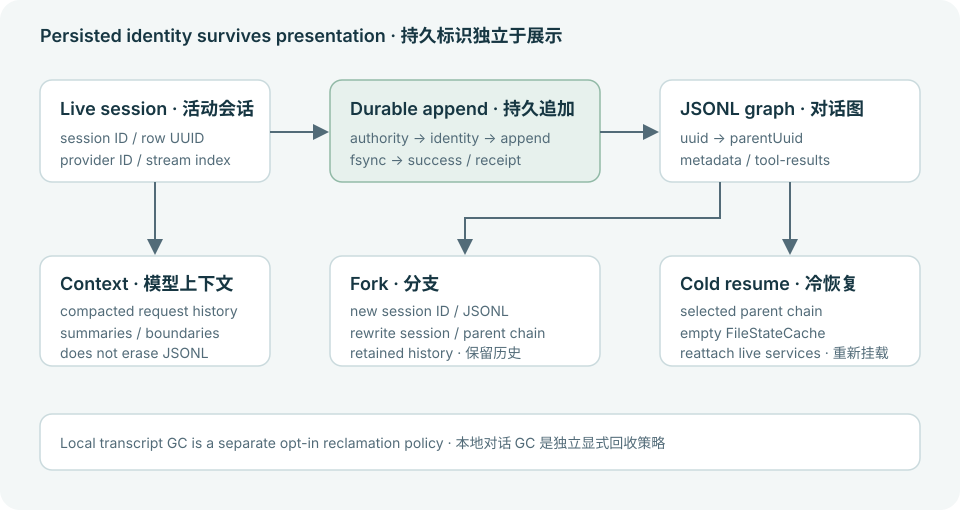

# 会话标识与持久化存储

理解 JSONL 图、稳定 UUID、冷恢复、分支及上下文压缩与对话存储回收的区别。

<a id="layout-and-ids"></a>

## 存储布局与标识

生产对话保存在 <config-home>/projects/<sanitized-cwd>/<session-uuid>.jsonl。较长的清洗 cwd 名称带确定性 DJB2 后缀。大型工具输出位于相邻 <session-uuid>/tool-results 目录，而不是项目工作空间内。Rollout 记录有独立底层 schema 和策略，两种格式不能互换。

Session ID 标识挂载对话。外层 JSONL UUID 标识持久化行，parentUuid 连接图。供应商响应 ID 标识远端响应。宿主 stream index 保持展示顺序，即使行消失也保留单调水位。文本与视觉位置不能作为恢复时间或解决重复的键。



恢复复用来源会话；分支创建新会话标识。上下文压缩自身不会抹去历史对话。

<a id="durability"></a>

## 追加与发布屏障

durable writer 固定文件系统根与 handle，持有会话状态权限，检查交付标识，追加并 fsync 后才确认成功。相同交付标识及内容的重试返回 AlreadyPresent；同标识但内容冲突则失败。已写入文件但持久化失败仍属于发布失败，直到重试跨过屏障。

UI 交付、对话快照与持久追加是独立边界。展示持久化警告并保留重试信息。关闭由所属生命周期协调器排空；不能仅由 MessageComplete 或 TurnEnded 推断持久化。

<a id="resume-and-fork"></a>

## 冷恢复与分支

reader 区分图行与 metadata，按 UUID 建索引，同 UUID 采用最后一次记录。恢复重建选定父链与锚定工具结果。直接读取文件行可用于诊断，但不是恢复算法。

SessionResumer 恢复消息与 metadata，并创建空 FileStateCache，避免历史 Read 状态支持过期文件假设。权限、插件／MCP 连接、输出样式和计费由 runtime 组合重新挂载。分支创建新 session JSONL，并重写会话标识／父链／sidechain 事实，不是简单改名原文件。

在 CLI 中，/branch 创建这种相邻对话并为用户挂载；/fork 是另一个操作，启动脱离前台的后台 Agent。选择宿主命令时应依据实际行为，不能假设所有名为 fork 的操作都创建相同会话生命周期。

<a id="compaction"></a>

## 两种不同的压缩

| 操作 | 目的与负责人 |
| --- | --- |
| 模型上下文压缩 | Orchestrator／compaction 通过摘要、边界和保留状态减少后续请求上下文，保留重放与宿主投影所需的持久化历史。 |
| 本地对话存储回收 | session／jsonl／transcript_compact 回收被替代的 metadata。本地 GC 默认关闭，受 LINGXI_TRANSCRIPT_LOCAL_GC 控制，与模型上下文窗口策略不同。 |

不要通过手工编辑活动 JSONL 减少 token。使用 orchestrator 压缩接口，切换或恢复会话时保留 writer 权限与 session epoch。

<a id="inspection"></a>

## 只读诊断示例

此脚本统计记录类型与重复 UUID，不打印提示文本、凭据或工具载荷。传入复制后的对话文件路径。它明确报告格式错误行，不会静默将其展示为有效恢复会话。

- 现有 session 测试覆盖 golden JSONL、重复 UUID、父链恢复、分支名称及对话压缩接通。Orchestrator 测试另行覆盖持久追加警告与时间投影。
- 目标文件系统上的崩溃恢复、中断写入与带真实附件的冷恢复需要端到端宿主验收。可解析的副本仅提供诊断证据。

### Python · 检查已复制的 JSONL

```python
import collections
import json
import pathlib
import sys

counts = collections.Counter()
uuids = collections.Counter()
for line_no, line in enumerate(pathlib.Path(sys.argv[1]).read_text().splitlines(), 1):
    try:
        row = json.loads(line)
    except json.JSONDecodeError:
        print(f"malformed line: {line_no}")
        continue
    if not isinstance(row, dict):
        print(f"non-object line: {line_no}")
        continue
    counts[str(row.get("type", "unknown"))] += 1
    if isinstance(row.get("uuid"), str):
        uuids[row["uuid"]] += 1
print("record types:", dict(sorted(counts.items())))
print("duplicate UUID count:", sum(count > 1 for count in uuids.values()))
```

验证方式: 需环境验证

## 源码与文档基线

[源码仓库](https://github.com/lingxi-coder/harness-runtime)

- [harness-runtime/crates/session/src/jsonl/path.rs](https://github.com/lingxi-coder/harness-runtime/blob/1c08d9265d9a4fbf20d59c0776ddbfb96cb03e4d/crates/session/src/jsonl/path.rs) — 已提交源码 (1c08d9265d9a4fbf20d59c0776ddbfb96cb03e4d)
- [harness-runtime/crates/session/src/jsonl/schema.rs](https://github.com/lingxi-coder/harness-runtime/blob/1c08d9265d9a4fbf20d59c0776ddbfb96cb03e4d/crates/session/src/jsonl/schema.rs) — 已提交源码 (1c08d9265d9a4fbf20d59c0776ddbfb96cb03e4d)
- [harness-runtime/crates/session/src/jsonl/reader.rs](https://github.com/lingxi-coder/harness-runtime/blob/1c08d9265d9a4fbf20d59c0776ddbfb96cb03e4d/crates/session/src/jsonl/reader.rs) — 已提交源码 (1c08d9265d9a4fbf20d59c0776ddbfb96cb03e4d)
- [harness-runtime/crates/session/src/jsonl/recovery.rs](https://github.com/lingxi-coder/harness-runtime/blob/1c08d9265d9a4fbf20d59c0776ddbfb96cb03e4d/crates/session/src/jsonl/recovery.rs) — 已提交源码 (1c08d9265d9a4fbf20d59c0776ddbfb96cb03e4d)
- [harness-runtime/crates/session/src/jsonl/durable_writer.rs](https://github.com/lingxi-coder/harness-runtime/blob/1c08d9265d9a4fbf20d59c0776ddbfb96cb03e4d/crates/session/src/jsonl/durable_writer.rs) — 已提交源码 (1c08d9265d9a4fbf20d59c0776ddbfb96cb03e4d)
- [harness-runtime/crates/session/src/jsonl/message_identity.rs](https://github.com/lingxi-coder/harness-runtime/blob/1c08d9265d9a4fbf20d59c0776ddbfb96cb03e4d/crates/session/src/jsonl/message_identity.rs) — 已提交源码 (1c08d9265d9a4fbf20d59c0776ddbfb96cb03e4d)
- [harness-runtime/crates/session/src/jsonl/transcript_compact.rs](https://github.com/lingxi-coder/harness-runtime/blob/1c08d9265d9a4fbf20d59c0776ddbfb96cb03e4d/crates/session/src/jsonl/transcript_compact.rs) — 已提交源码 (1c08d9265d9a4fbf20d59c0776ddbfb96cb03e4d)
- [harness-runtime/crates/session/src/resumer.rs](https://github.com/lingxi-coder/harness-runtime/blob/1c08d9265d9a4fbf20d59c0776ddbfb96cb03e4d/crates/session/src/resumer.rs) — 已提交源码 (1c08d9265d9a4fbf20d59c0776ddbfb96cb03e4d)
- [harness-runtime/crates/session/src/branch.rs](https://github.com/lingxi-coder/harness-runtime/blob/1c08d9265d9a4fbf20d59c0776ddbfb96cb03e4d/crates/session/src/branch.rs) — 已提交源码 (1c08d9265d9a4fbf20d59c0776ddbfb96cb03e4d)
- [harness-runtime/crates/orchestrator/src/conversation/compaction.rs](https://github.com/lingxi-coder/harness-runtime/blob/1c08d9265d9a4fbf20d59c0776ddbfb96cb03e4d/crates/orchestrator/src/conversation/compaction.rs) — 已提交源码 (1c08d9265d9a4fbf20d59c0776ddbfb96cb03e4d)
- [harness-runtime/crates/client/src/adapter/lowering/messages.rs](https://github.com/lingxi-coder/harness-runtime/blob/1c08d9265d9a4fbf20d59c0776ddbfb96cb03e4d/crates/client/src/adapter/lowering/messages.rs) — 已提交源码 (1c08d9265d9a4fbf20d59c0776ddbfb96cb03e4d)
- [harness-runtime/crates/runtime/src/desktop/session_state/resume.rs](https://github.com/lingxi-coder/harness-runtime/blob/1c08d9265d9a4fbf20d59c0776ddbfb96cb03e4d/crates/runtime/src/desktop/session_state/resume.rs) — 已提交源码 (1c08d9265d9a4fbf20d59c0776ddbfb96cb03e4d)

- harness-runtime: HEAD 1c08d9265d9a4fbf20d59c0776ddbfb96cb03e4d; 所据文件指纹 sha256:d77506e15375f8653d0ae9198567f3dbeba4e931dce8226b58971350a635ae8a; 产品固定版本 1c08d9265d9a4fbf20d59c0776ddbfb96cb03e4d

<!-- Generated from apps/web/src/data/docs. Do not edit this file directly. -->
