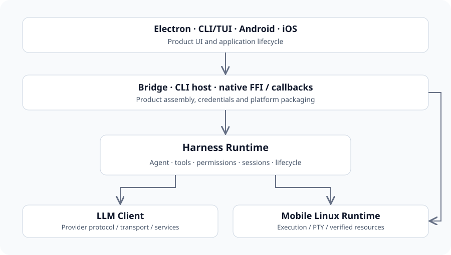

# 系统架构与责任边界

理解产品宿主、共享 Agent 运行时、模型 SDK 和本地执行层的关系，以及各层的责任与实现边界。

## 四个独立仓库

相邻目录便于开发，但每个仓库拥有独立 Git 历史、锁文件、门禁和发行身份。产品 Cargo 依赖选择固定 SDK revision；相邻工作树不会自动替换这些依赖。

| 层 | 负责 | 消费契约 |
| --- | --- | --- |
| lingxi-app | 界面、CLI/TUI、Bridge、原生包装、回调、签名与产品资源 | SDK 门面、共享客户端 DTO、资源契约 |
| harness-runtime | Agent 执行、会话、工具、权限、沙箱、扩展与生命周期装配 | 宿主注入服务与平台 trait |
| llm-client | Provider 编解码、连接、传输、归一化流与服务 API | 请求、准备调用与 Provider 能力 |
| mobile-linux-runtime | Linux 执行、PTY、资源验证及平台绑定 | 运行时 API 与显式资源、策略输入 |

箭头表示消费关系，不表示部署方式或自动替换本地依赖。

## 宿主与组合入口

Electron 运行本地 Rust Bridge 并使用内部 TypeScript 客户端；CLI/TUI 直接使用桌面组合；Android 和 iOS 通过本地 Rust FFI 与原生回调接入。当前 apps/web 是官网与 SDK 文档，并保留原型页面，不能据此认定已部署浏览器 Agent 服务。

- [产品与平台集成](platform-integration.md)
- [Harness 生命周期](harness-lifecycle.md)

## 工作树、HEAD 与产品固定版本

本手册描述所引用的工作树文件。HEAD 标识已提交基线，产品固定版本标识声明的依赖，两者可能不同。新增或与 HEAD 内容不同的文件不生成提交行号链接；指纹标识输入字节，但不能让未提交源码通过远程 Git 获取。

依赖身份与集成状态需要分别核对。记录新 SDK 接口不等于产品已使用该接口构建。

## 平台能力与不可用服务

平台实现提供文件、进程、凭据、沙箱和设备服务，共享 Agent 负责执行流程。不可用能力应保留明确结果。桌面平台代码、移动原生执行和模型托管工具拥有不同的权限与取消责任方。

- [Mobile Linux 可用性与资源](mobile-linux.md)
- [权限与沙箱](harness-tools.md)

## 相关独立系统

Computer Use 和 Local App Market 拥有自己的架构及实现证据。同处父目录不代表存在依赖关系，也不证明全部能力已经集成到本产品。评估这些项目时应阅读各自当前文档与状态记录。

- [Computer Use 仓库](https://github.com/lingxi-coder/computer-use)
- [Local App Market 仓库](https://github.com/lingxi-coder/local-app-market)

## 源码与文档基线

[源码仓库](https://github.com/lingxi-coder/lingxi-app)

- [lingxi-app/Cargo.toml](https://github.com/lingxi-coder/lingxi-app/blob/d1840b78301dae46c8cf076eddc0b3eef1610279/Cargo.toml) — 已提交源码 (d1840b78301dae46c8cf076eddc0b3eef1610279)
- [harness-runtime/crates/runtime/Cargo.toml](https://github.com/lingxi-coder/harness-runtime/blob/dc6ce1217143b693d97ab6278ff66568beea20d3/crates/runtime/Cargo.toml) — 已提交源码 (dc6ce1217143b693d97ab6278ff66568beea20d3)
- [harness-runtime/crates/runtime/src/api.rs](https://github.com/lingxi-coder/harness-runtime/blob/dc6ce1217143b693d97ab6278ff66568beea20d3/crates/runtime/src/api.rs) — 已提交源码 (dc6ce1217143b693d97ab6278ff66568beea20d3)
- [llm-client/src/lib.rs](https://github.com/lingxi-coder/llm-client/blob/a363c5b3a237d53eea12c3abfb3b98648ef15d3e/src/lib.rs) — 已提交源码 (a363c5b3a237d53eea12c3abfb3b98648ef15d3e)
- [mobile-linux-runtime/Cargo.toml](https://github.com/lingxi-coder/mobile-linux-runtime/blob/6b033d41a2b6b736fda1e8f996f55a4b20bd885d/Cargo.toml) — 已提交源码 (6b033d41a2b6b736fda1e8f996f55a4b20bd885d)

- lingxi-app: HEAD d1840b78301dae46c8cf076eddc0b3eef1610279; 所据文件指纹 sha256:302434a272a31c7fc1d4f0c764107332cbbef9d6977bde52add1d448b51dc5ae
- harness-runtime: HEAD dc6ce1217143b693d97ab6278ff66568beea20d3; 所据文件指纹 sha256:a83d44fb79099d3a923f8fd33bfd18789edd02c2b1d5c683a16c589fffaf2578; 产品固定版本 dc6ce1217143b693d97ab6278ff66568beea20d3
- llm-client: HEAD a363c5b3a237d53eea12c3abfb3b98648ef15d3e; 所据文件指纹 sha256:fdc3f37adcc11c571e4db361c4ea665e8ee4d2644a8724745b22389fb43c41d7; 产品固定版本 a363c5b3a237d53eea12c3abfb3b98648ef15d3e
- mobile-linux-runtime: HEAD 6b033d41a2b6b736fda1e8f996f55a4b20bd885d; 所据文件指纹 sha256:435a888b1a310f357f18311df5f96418fa72b1a900d78e987af282bb3e91d7ca; 产品固定版本 6b033d41a2b6b736fda1e8f996f55a4b20bd885d

<!-- Generated from apps/web/src/data/docs. Do not edit this file directly. -->
